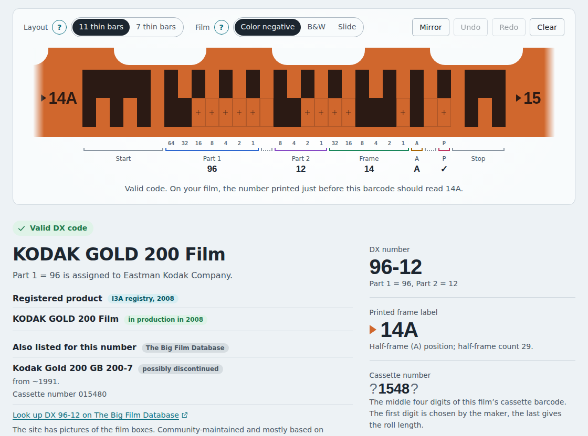

# DX Film Edge Decoder

Identify a 35 mm film from the barcode along the edge of your negatives and
slides: copy the bars you see, and the decoder tells you the film, its maker
and the frame number.

**[Open the decoder → ricebucket.github.io/dx-film-edge-decoder](https://ricebucket.github.io/dx-film-edge-decoder/)**



Most 35 mm film made since 1983 carries a DX barcode along one edge. It is
exposed at the factory and appears when the film is developed, so it is still
there on negatives and slides long after the cassette has been thrown away.
This tool is for film photographers, collectors and archivists who want to
know what a strip of film is.

Everything runs in your browser. Photos you open in it are not uploaded to any
server. It also works when `site/index.html` is opened straight from disk.

[Watch the demo video](.github/demo.webm) (about 35 seconds)

## What it does

- **An interactive copy of the film edge**, drawn like real film, that decodes
  as you go: the film and its manufacturer, the DX number, the frame number
  as printed (`23`, `23A`, `X`, `00` …) and the matching cassette number.
- **Checks with explanations**, and when a bar was misread, the one-bar
  corrections that give a valid code, known films first.
- **Older film**: the original 23-cell code from before the 1990 frame-number
  extension is supported alongside the current 31-cell one.
- **Read a photo or scan**: the decoder finds the barcode itself, even on
  mirrored or upside-down film and on slides, and shows which cells it read.
  The photo then stays in view, its barcode lined up over the strip's cells.
- **Find a film's code** by name or DX number, **look up a cassette number**,
  and browse the **2008 DX code list**. A code shown from any of them says
  above the strip where it came from, with a way back.
- Undo and redo, shareable links such as `?dx=79-15/23`, light and dark themes,
  English or Simplified Chinese (from the language menu at the top, or in a
  link with `?lang=en` or `?lang=zh-CN`), and keyboard and screen-reader
  support.

## How to use it


1. **Find the barcode.** It runs between the sprocket holes and the edge of the
   film: two touching rows of small bars, about 13 mm long, repeated twice per
   frame. Use a loupe, a light table or a zoomed-in scan.
2. **Turn the film the right way around**, so the barcode is *below* the
   sprocket holes and the small printed numbers read normally. The top row then
   starts with a wide mark on the left. If the wide mark is on the right, you are
   looking at the back of the film: turn it over or switch on **Mirror**.
3. **Count the thin bars in the top row** between the wide marks: 11, or 7 for
   the original layout, found on older film and on some later film. Choose the
   matching **Layout**.
4. **Copy the lower row.** Select every cell where your film has a bar. With a
   mouse, drag to fill several; with a keyboard, select the first cell and type
   `1` and `0`.
   On slide film the bars are clear marks on a black edge; pick the black piece
   of film under the strip to draw them that way.
5. **Read the result.** The number printed just before the barcode on your film
   should match the decoded frame label. If the code fails its checks, look
   again at faint bars, compare with the next code along the film, or pick a
   suggested correction.

Instead of copying by hand, you can choose **Read a photo** at the top and
follow its three steps: choose a photo, check the barcode, use the code. The
photo then stays above the strip, with its barcode lined up over the strip's
cells.

## How the code works

The code has a fixed clock track (the top row) and a data track (the lower
row) holding the film's DX number, a frame number and a parity check. The
page's *How it works* section explains it for users; the
[research notes](research/) document every detail and how it was established,
from [the cell layout](research/01-edge-code-format.md) and
[frame numbers](research/02-frame-numbers.md) to
[reading real film](research/05-reading-real-film.md).


## Where the film names come from

- **The 2008 DX registry** of the International Imaging Industry Association,
  the most recent official list that is freely available
  ([research/03](research/03-dx-numbers-and-registry.md)).
- **[The Big Film Database](https://github.com/dxdatabase/Open-source-film-database)**,
  a community database that also covers films introduced since 2008 and
  rebranded films ([research/04](research/04-community-database.md)). When it
  lists films for a DX number, the decoder also links to that number on
  [Antoine Mérino's edition](https://thebigfilmdatabase.merinorus.com) of the
  database, which has pictures of the films.

The two are always labeled separately on the page. No code is given a meaning
that neither source documents: an unknown code is reported as unknown, together
with the manufacturer its Part 1 number belongs to.

## Running and developing

The web page is plain HTML, CSS and JavaScript with no dependencies and no
build step: open `site/index.html`, or run `npm start` and visit
<http://localhost:8080>. The scripts and tests need
[Node.js](https://nodejs.org/) 22 or later.

```
site/                 the web pages (deployed as is)
  js/dx-codec.js      barcode layout, encoding, decoding, checks
  js/dx-lookup.js     film lookups and search
  js/dx-image.js      reading codes from photos; synthetic test images
  js/dx-data*.js      film tables, generated from data/
  js/ui-*.js, app.js  the interface
  js/i18n.js, i18n/   interface languages (see Languages below)
data/                 film tables as CSV, see data/README.md
research/             research reports on the format and the data
  img/                their diagrams and screenshots
scripts/              data extraction and build, diagrams, screenshots,
                      demo videos, language check, local server, test runner
tests/unit/           unit tests (node:test)
tests/e2e/            browser and accessibility tests (Playwright, axe-core)
.github/workflows/    tests, license check and GitHub Pages deployment
LICENSES/, REUSE.toml license texts, and which files each one covers
```

### Tests

```sh
npm test            # unit tests: codec, data, lookups, photo reader, languages, diagrams, video writer, @phone tags
npm run test:e2e    # browser tests: desktop, Android phone, iPhone
```

The browser tests run in Chromium on a desktop screen and a Pixel 10 Pro, and
in WebKit, Safari's engine, on an iPhone 17 Pro. To run just one of them, add
`-- --project=desktop` (or `android`, `iphone`). They include accessibility
checks with [axe-core](https://github.com/dequelabs/axe-core) (its WCAG 2.2 A
and AA rules) in every language, in light and dark mode.

On GitHub, to save time, the browser tests run in four jobs at once: every
test on the desktop, split three ways, and on the two phones only the tests
tagged `@phone`, those that work differently on a phone or run only there. A
unit test checks those tags. On your own machine, `npm run test:e2e` runs
every test on all three.

The unit tests need nothing beyond Node. The browser tests use
[Playwright](https://playwright.dev/) and axe-core, which are deliberately
**not** dependencies of this project. Install them once on your machine,
outside this folder, either globally (with `sudo` if your global npm folder
needs it) or in a parent folder such as your home directory:

```sh
# globally
npm install -g @playwright/test @axe-core/playwright
playwright install --with-deps chromium webkit

# or in your home directory
cd ~ && npm install @playwright/test @axe-core/playwright && npx playwright install --with-deps chromium webkit
```

`npm run test:e2e` finds either installation. If Playwright is installed
somewhere else, and not in a parent folder, set `PLAYWRIGHT_DIR` to the
`node_modules` folder that contains `@playwright/test`. Test artifacts go to the
system's temporary folder.

### Film data

[data/README.md](data/README.md) describes the data files and
[how to update them](data/README.md#updating-the-data) when their sources
change.

### Languages

The pages come in English and Simplified Chinese; visitors choose the language
from the menu at the top. The decoder page (`site/index.html`) and the code
hold the English text, and every other language is one file in
`site/js/i18n/` that gives, for every English text, the text in that
language; the decoder page loads only the file of the language it is shown
in, and waits for it. If the file hasn't come after 3 seconds, the page says
so in that language, with a button to show itself in English. The sources page
is written once per language instead: `site/sources.html` in English,
`site/sources.zh-CN.html` in Chinese.

To add a language:

1. Copy `site/js/i18n/zh-CN.js` to a file named after the language code, for
   example `site/js/i18n/de.js`. Set `code`, `name` (the language's name in
   that language) and `punctuation`, and replace every Chinese text with the
   new language's. Keep the `{placeholders}`, any HTML tags, and film and
   product names as they are. Where the language has several plural forms, a
   text can be an object such as `{ one: …, few: …, many: …, other: … }`.
2. Add the language to the list at the end of `site/js/prepaint.js`, with
   its code and name. Give it, in the language, the note the page shows when
   the file is slow to come (`waiting`) and the button that then shows the
   page in English (`english`). From then on the decoder page loads the file
   for visitors who choose the language, and its language menu lists it. Also
   add the language's version of the message for visitors without JavaScript
   to the `<noscript>` block of `site/index.html`, marked with `lang`: the
   language files cannot supply it, since they need JavaScript.
3. Copy `site/sources.html` to a file named after the language code, for
   example `site/sources.de.html`, and write its text in the new language.
   Set `lang` on `<html>`, add the language to the links to `index.html`
   (`index.html?lang=de#decoder`), and mark the language as `selected` in the
   menu. Then add the language to the menu of every version of the sources
   page.
4. Run `npm run check:languages`. It lists English texts the language lacks,
   texts whose English is no longer used, and texts whose placeholders or tags
   differ from the English, and says if the message for visitors without
   JavaScript is missing. It also checks that `site/js/prepaint.js` lists
   every language file, with both texts, and compares each version of the
   sources page with the English one: they need the same elements, links and
   menu, and the same header text as the decoder page. `npm test` runs the
   same check.
5. Add the language's labels to `LABELS` in `scripts/make-figures.mjs`, then
   run `npm run figures`, `npm run screenshots` and `npm run demo` so the
   diagrams, screenshots and demo videos exist in the new language.

`npm run check:languages -- --template` prints every English text of the
page, as a starting point. When you change or add English text in `site/`,
update every language file in the same change: the tests fail until you do.
When you change the sources page, make the same change in each of its
versions, as for the documentation. The check notices a source added or
removed and a changed link, but not changed wording.

Code looks up each text with `t('…')` when it draws it, never as its script
loads: the language file can come after the scripts, and a text looked up
before it would stay in English. A browser test holds the file back and fails
on any text looked up too early.

The documentation comes in two parallel versions, English and Simplified
Chinese: `README.zh-CN.md` sits next to `README.md`, and so on. Both versions
say the same things, and the links in each lead to the other files in the same
language. When you change one version, make the same change in the other.

### Diagrams and screenshots

- The diagrams in `research/img/*.svg` are drawn from the decoder's own code
  by `npm run figures`, in every language. `npm test` fails if they are out of
  date.
- The screenshots (`.github/screenshot*.png` and `research/img/*.png`) are
  taken by `npm run screenshots`, which needs Playwright (see *Tests*). They
  use the fonts installed on your machine, so the Chinese ones need a Chinese
  font (on Ubuntu, the `fonts-noto-cjk` package). Run it after every visible
  change to the page, and look at the results before committing them.
- The demo video (`.github/demo*.webm`, 1120 × 840) and a vertical version
  (`.github/demo-vertical*.mp4`, 1120 × 1680) are recorded by `npm run demo`,
  which also needs Playwright: about half a minute each, in each language.
  It uses the page as a visitor would, copying a black-and-white film's code
  with one bar missed, taking the correction, and reading the sample photo of
  a color negative, so run it after visible changes to those parts, and watch
  the results before committing them.

## License and sources

The code, tests, scripts and documentation are free software under the
[GNU General Public License v3.0](LICENSE), except the screenshots and demo
videos that show entries of The Big Film Database, which are under CC BY-SA 4.0.
The film data has its own sources and terms, described in
[data/README.md](data/README.md). Every source used for the project is listed
in [research/06](research/06-sources-and-licensing.md).

The license of every file is also recorded in [`REUSE.toml`](REUSE.toml), in
the [REUSE](https://reuse.software/) format, and the tests on GitHub check it.
To check it yourself, install the REUSE tool (for example with
`pipx install reuse`) and run `reuse lint`. Every file has one license, so
material added from elsewhere needs an entry there, and a file of its own if its
license differs.
