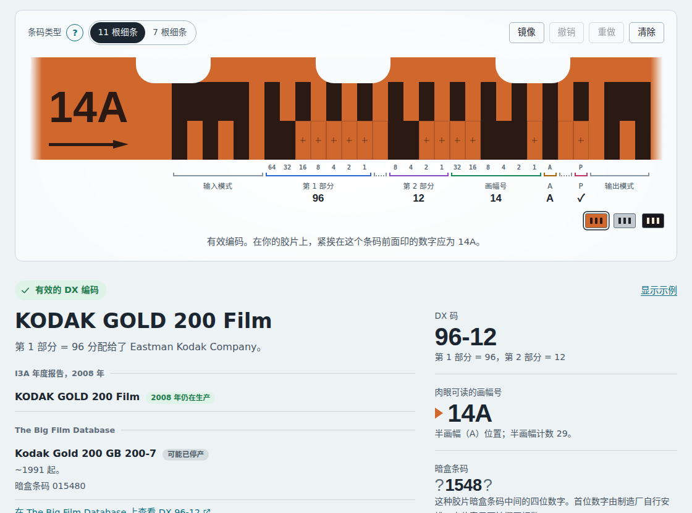
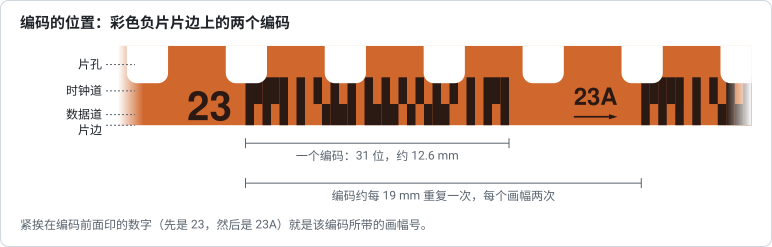

# DX 潜影条码解码器

根据负片和反转片片边上的条码识别 135 规格胶片：照着你看到的条抄写一遍，解码器就会告诉你是哪种胶片、它的制造厂以及画幅号。

**[打开解码器 → ricebucket.github.io/dx-film-edge-decoder](https://ricebucket.github.io/dx-film-edge-decoder/)**



1983 年以来生产的 135 规格胶片大多沿一侧片边带有 DX 潜影条码。它在工厂里曝光，在胶片加工后显现出来，所以在暗盒被丢弃很久之后，它仍然留在负片和反转片上。本工具面向胶片摄影师、收藏者和档案工作者，帮助他们认出一段胶片是哪种胶片。

一切都在你的浏览器中运行。你在页面中打开的照片不会上传到任何服务器。直接从磁盘打开 `site/index.html` 时也能使用。

[观看演示视频](.github/demo.zh-CN.webm)（约 35 秒）

## 功能

- **可交互的片边副本**，画得和真实胶片一样，边抄写边解码：胶片及其制造厂、DX 码、片边上印的画幅号（`23`、`23A`、`X`、`00`……）以及对应的暗盒条码。
- **带说明的检查**；如果有条读错了，还会给出只改一位就能得到有效编码的修正，已知胶片列在前面。
- **较旧的胶片**：除了现行的 31 位条码，也支持 1990 年画幅号扩展之前的原始 23 位条码。
- **读取照片或扫描件**：解码器会自己找到条码，即使胶片是镜像的、上下颠倒的或者是反转片也能找到，并显示它读取了哪些单元。之后照片会留在视野中，照片上的条码与片条的各单元逐一对齐。
- 按名称或 DX 码**查找胶片的编码**，**查询暗盒条码**，以及浏览 **2008 年 DX 码列表**。从这些地方显示的编码，会在片条上方注明来源，并提供返回的入口。
- 撤销和重做，`?dx=79-15/23` 这样的可分享链接，浅色和深色主题，英文或简体中文（在顶部的语言菜单中选择，或在链接中用 `?lang=en` 或 `?lang=zh-CN` 指定），以及键盘和屏幕阅读器支持。

## 使用方法



1. **查找条码**。它位于片孔和胶片边缘之间：两道紧挨着的小条，长约 13 mm，每个画幅重复两次。可以借助放大镜、看片台或放大的扫描图。
2. **把胶片转到正确的方向**，让条码位于片孔*下方*，并且片边上印的小数字能正常阅读。这样，时钟道从左边的一个宽标记开始。如果宽标记在右边，你看到的是胶片的背面：把胶片翻过来，或打开**镜像**（Mirror）。
3. **数一数时钟道两个宽标记之间的细条**：11 根；或者 7 根，即最初的条码格式，见于较旧的胶片和一些后来的胶片。选择相应的**条码类型**（Layout）。
4. **抄写数据道**。你的胶片上哪个单元有条，就选择哪个单元。用鼠标时，拖动可以一次填充多个单元；用键盘时，选择第一个单元后输入 `1` 和 `0`。在反转片上，条是黑色片边上的透明标记；选择片条下方黑色的那一小块胶片，片条就会这样绘制。
5. **查看结果**。你的胶片上紧挨在条码前面印的数字，应当与解码结果中的“肉眼可读的画幅号”一致。如果编码没有通过检查，请再看一看较淡的条，与胶片上的下一个编码比较，或者选择一个建议的修正。

除了手动抄写，也可以在顶部选择**读取照片**（Read a photo），按三个步骤操作：选择照片，检查条码，使用编码。之后照片会留在片条上方，照片上的条码与片条的各单元逐一对齐。

## 编码原理

条码包括一条固定的时钟道（上面）和一条数据道（下面），数据道中存有胶片的 DX 码、画幅号和奇偶检验位。网页上的*原理*（How it works）部分面向用户作了解释；[研究笔记](research/README.zh-CN.md)记录了每一个细节以及它是怎样确定的，从[条码格式](research/01-edge-code-format.zh-CN.md)、[画幅号](research/02-frame-numbers.zh-CN.md)一直到[读取真实胶片](research/05-reading-real-film.zh-CN.md)。


## 胶片名称的来源

- 国际影像行业协会（I3A）的 **2008 年 DX 码年度报告**，这是可以免费获取的最新官方列表（[research/03](research/03-dx-numbers-and-registry.zh-CN.md)）。
- **[The Big Film Database](https://github.com/dxdatabase/Open-source-film-database)**，一个社区数据库，也收录了 2008 年以来推出的胶片和贴牌胶片（[research/04](research/04-community-database.zh-CN.md)）。如果该数据库中有某个 DX 码下的胶片，解码器还会链接到 [Antoine Mérino 的修改版](https://thebigfilmdatabase.merinorus.com)数据库中的这个 DX 码，那里有这些胶卷的图片。

页面上始终分别标注这两个来源。任何编码都不会被赋予两个来源都没有记载的含义：未知编码会报告为未知，同时给出其第 1 部分编号所属的感光厂。

## 运行与开发

网页是纯 HTML、CSS 和 JavaScript，没有依赖，也没有构建步骤：打开 `site/index.html`，或者运行 `npm start` 后访问 <http://localhost:8080>。脚本和测试需要 [Node.js](https://nodejs.org/) 22 或更高版本。

```
site/                 网页（按原样部署）
  js/dx-codec.js      条码格式、编码、解码、检查
  js/dx-lookup.js     胶片查询和搜索
  js/dx-image.js      从照片中读取编码；合成测试图像
  js/dx-data*.js      胶片数据表，由 data/ 生成
  js/ui-*.js, app.js  界面
  js/i18n.js, i18n/   界面语言（见下文“语言”）
data/                 CSV 格式的胶片数据表，见 data/README.md
research/             关于格式和数据的研究报告
  img/                报告中的图示和截图
scripts/              数据提取与构建、图示、截图、
                      演示视频、语言检查、本地服务器、测试运行器
tests/unit/           单元测试（node:test）
tests/e2e/            浏览器和无障碍测试（Playwright、axe-core）
.github/workflows/    测试、许可证检查和 GitHub Pages 部署
LICENSES/, REUSE.toml 许可证全文，以及每种许可证适用于哪些文件
```

### 测试

```sh
npm test            # 单元测试：编解码器、数据、查询、照片读取、语言、图示、视频写入、@phone 标记
npm run test:e2e    # 浏览器测试：桌面、Android 手机、iPhone
```

浏览器测试在 Chromium 中以桌面屏幕和 Pixel 10 Pro 运行，并在 Safari 的内核 WebKit 中以 iPhone 17 Pro 运行。只想运行其中一种时，加上 `-- --project=desktop`（或 `android`、`iphone`）。浏览器测试还包括用 [axe-core](https://github.com/dequelabs/axe-core) 进行的无障碍检查（它的 WCAG 2.2 A 级和 AA 级规则），覆盖每种语言以及浅色和深色模式。

在 GitHub 上，为了节省时间，浏览器测试分成四个任务同时运行：全部测试都在桌面上运行，分成三份；两种手机只运行标记为 `@phone` 的测试，也就是在手机上表现不同或只在手机上运行的测试。有一项单元测试检查这些标记。在你自己的机器上，`npm run test:e2e` 会在三种设备上运行全部测试。

单元测试除了 Node 之外不需要别的东西。浏览器测试使用 [Playwright](https://playwright.dev/) 和 axe-core，它们有意**不**作为本项目的依赖。请在你的机器上、本文件夹之外安装一次：可以全局安装（如果你的全局 npm 文件夹需要，就加上 `sudo`），也可以安装在上级文件夹中，例如你的主目录：

```sh
# 全局安装
npm install -g @playwright/test @axe-core/playwright
playwright install --with-deps chromium webkit

# 或者安装在你的主目录中
cd ~ && npm install @playwright/test @axe-core/playwright && npx playwright install --with-deps chromium webkit
```

`npm run test:e2e` 能找到这两种安装中的任意一种。如果 Playwright 安装在别处，而且不在上级文件夹中，请把 `PLAYWRIGHT_DIR` 设为包含 `@playwright/test` 的那个 `node_modules` 文件夹。测试产物会存放在系统的临时文件夹中。

### 胶片数据

[data/README.zh-CN.md](data/README.zh-CN.md) 介绍了各个数据文件，以及在它们的来源发生变化时[如何更新它们](data/README.zh-CN.md#更新数据)。

### 语言

页面有英文和简体中文两种语言；访问者可以在页面顶部的菜单中选择语言。解码器页面（`site/index.html`）和代码中是英文文字，其他每种语言都是 `site/js/i18n/` 中的一个文件，为每一段英文给出该语言的文字；解码器页面只加载它所显示的那种语言的文件，并等它加载完成。如果 3 秒后这个文件还没到，页面会用该语言说明情况，并给出改用英文显示的按钮。来源页面则每种语言各写一份：英文是 `site/sources.html`，中文是 `site/sources.zh-CN.html`。

添加一种语言：

1. 把 `site/js/i18n/zh-CN.js` 复制为以语言代码命名的文件，例如 `site/js/i18n/de.js`。设置 `code`、`name`（用该语言本身写的语言名称）和 `punctuation`，并把其中的中文全部换成新语言的文字。`{placeholders}`、HTML 标签以及胶片和产品名称都保持原样。如果该语言有多种复数形式，文字可以写成对象，例如 `{ one: …, few: …, many: …, other: … }`。
2. 在 `site/js/prepaint.js` 末尾的列表中加入该语言的代码和名称，并用该语言写出语言文件迟迟未到时页面显示的提示（`waiting`）和此时改用英文显示的按钮（`english`）。之后解码器页面会为选择该语言的访问者加载这个文件，语言菜单也会列出它。另外在 `site/index.html` 的 `<noscript>` 部分加上该语言版本的、给未启用 JavaScript 的访问者看的提示，并用 `lang` 标明语言：语言文件需要 JavaScript，所以无法提供这段文字。
3. 把 `site/sources.html` 复制为以语言代码命名的文件，例如 `site/sources.de.html`，并用新语言写出其中的文字。在 `<html>` 上设置 `lang`，在指向 `index.html` 的链接上加上该语言（`index.html?lang=de#decoder`），并在菜单中把该语言标为 `selected`。然后在来源页面每个版本的菜单中加上该语言。
4. 运行 `npm run check:languages`。它会列出该语言缺少的英文文字、对应英文已不再使用的文字，以及占位符或标签与英文不一致的文字；缺少给未启用 JavaScript 的访问者看的提示时，它也会指出。它还会检查 `site/js/prepaint.js` 是否列出了每一个语言文件及其两段文字，并把来源页面的每个版本与英文版比较：两者需要有相同的元素、链接和菜单，页头的文字也要与解码器页面相同。`npm test` 也会运行同样的检查。
5. 在 `scripts/make-figures.mjs` 的 `LABELS` 中加入该语言的标签，然后运行 `npm run figures`、`npm run screenshots` 和 `npm run demo`，这样图示、截图和演示视频也会有这种语言的版本。

`npm run check:languages -- --template` 会打印页面上的全部英文文字，可以作为起点。修改或添加 `site/` 中的英文文字时，请在同一次修改中更新每一个语言文件：在此之前测试不会通过。修改来源页面时，请在它的每个版本中做同样的修改，和文档一样。检查能发现增删的来源和改动的链接，但发现不了措辞的改动。

代码在显示文字时才用 `t('…')` 查找它，而不是在脚本加载时：语言文件可能比脚本晚到，在它之前查找的文字会一直是英文。有一项浏览器测试会故意推迟语言文件，只要有文字查找得太早就会失败。

文档有英文和简体中文两个平行的版本：`README.zh-CN.md` 放在 `README.md` 旁边，其余文件也一样。两个版本的内容相同，各自的链接都通向同一语言的其他文件。修改其中一个版本时，请在另一个版本中做同样的修改。

### 图示与截图

- `research/img/*.svg` 中的图示由 `npm run figures` 根据解码器自身的代码绘制，每种语言各一份。如果图示过时，`npm test` 会失败。
- 截图（`.github/screenshot*.png` 和 `research/img/*.png`）由 `npm run screenshots` 生成，需要 Playwright（见*测试*）。截图使用你机器上安装的字体，所以中文截图需要中文字体（在 Ubuntu 上是 `fonts-noto-cjk` 软件包）。每次页面有可见的改动后都要运行它，并在提交前检查生成的图片。
- 演示视频（`.github/demo*.webm`，1120 × 840）和竖版视频（`.github/demo-vertical*.mp4`，1120 × 1680）由 `npm run demo` 录制，同样需要 Playwright：每种语言各一段，每段约半分钟。它像访问者那样使用页面：抄写一种黑白片的编码时漏抄一根条，采用给出的修正，再读取彩色负片的示例照片。所以这些部分有可见的改动后都要运行它，并在提交前看一遍生成的视频。

## 许可证与来源

代码、测试、脚本和文档是自由软件，采用 [GNU General Public License v3.0](LICENSE) 许可证；显示了 The Big Film Database 条目的截图和演示视频除外，它们采用 CC BY-SA 4.0 许可证。胶片数据有自己的来源和条款，见 [data/README.zh-CN.md](data/README.zh-CN.md)。本项目使用的每一个来源都列在 [research/06](research/06-sources-and-licensing.zh-CN.md) 中。

每个文件的许可证还以 [REUSE](https://reuse.software/) 格式记录在 [`REUSE.toml`](REUSE.toml) 中，GitHub 上的测试会检查它。要自己检查，请安装 REUSE 工具（例如用 `pipx install reuse`），然后运行 `reuse lint`。每个文件只有一种许可证，所以从别处加入的材料需要在其中添加一项；如果它的许可证不同，还要放在单独的文件中。
