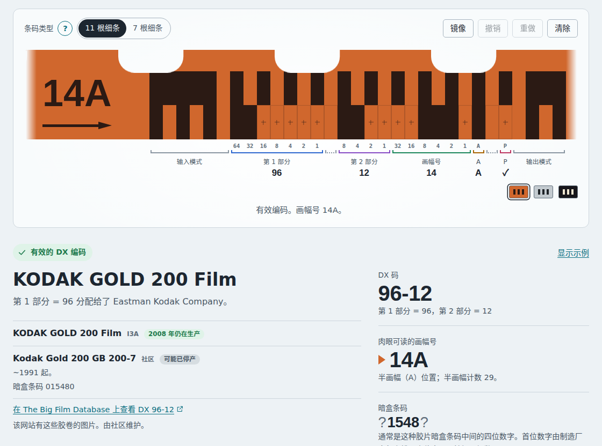
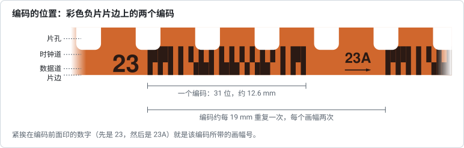
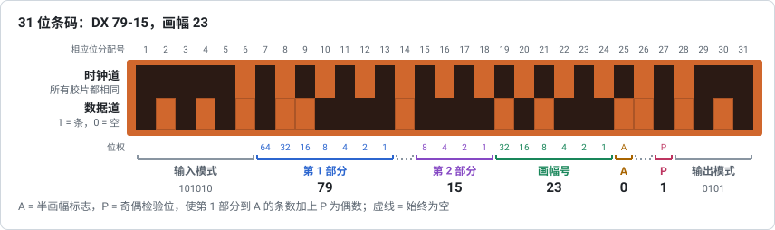

# DX潜影条码解码器

根据负片和反转片片边上的条码识别 135 规格胶片：照着胶片上的条填写一遍，解码器就会显示是哪种胶片、它的制造厂以及画幅号。

**[打开解码器 → ricebucket.github.io/dx-film-edge-decoder](https://ricebucket.github.io/dx-film-edge-decoder/)**



1983 年以来生产的 135 规格胶片大多沿一侧片边带有DX潜影条码。它在工厂里曝光，在胶片加工后显现出来，所以在暗盒被丢弃很久之后，它仍然留在负片和反转片上。本工具面向胶片摄影师、收藏者和档案工作者，帮助他们认出一段胶片是哪种胶片。

一切都在浏览器中运行。在页面中打开的照片不会上传到任何服务器。直接从磁盘打开 `site/index.html` 时也能使用。

[观看演示视频](.github/demo.zh-CN.webm)（约 40 秒）

## 功能

- **可交互的片边副本**，画得和真实胶片一样，边填写边解码：胶片及其制造厂、DX码、片边上印的画幅号（`23`、`23A`、`X`、`00`……）以及对应的暗盒编号。
- **带说明的检查**；如果有条读错了，还会给出只改一位就能得到有效编码的修正，已知胶片列在前面。
- **较旧的胶片**：除了现行的 31 位条码，也支持 1990 年画幅号扩展之前的原始 23 位条码。
- **读取照片或扫描件**：解码器会自己找到条码，即使胶片是镜像的、上下颠倒的或者是反转片也能找到，并显示它读取了哪些单元。之后照片会留在视野中，照片上的条码与片条的各单元逐一对齐。
- 按名称或制造厂**查找胶片的编码**，**查询暗盒编号**，以及浏览 **2008 年DX码列表**。从这些地方显示的编码，会在片条上方注明来源，并提供返回的入口。
- 撤销和重做，`?dx=79-15/23` 这样的可分享链接，浅色和深色主题，英文或简体中文（起初跟随浏览器的语言；可在顶部的语言菜单中更改，或在链接中用 `?lang=en` 或 `?lang=zh-CN` 指定），以及键盘和屏幕阅读器支持。

## 使用方法



1. **查找条码**。它位于片孔和胶片边缘之间：紧挨着的两排小条，长约 13 mm，每个画幅重复两次。可以借助放大镜、看片台或放大的扫描图。
2. **把胶片转到正确的方向**，让条码位于片孔*下方*，并且片边上印的小数字能正常阅读。这样，上排从左边的一个宽标记开始。如果宽标记在右边，那就是胶片的背面：把胶片翻过来，或打开**镜像**（Mirror）。
3. **数一数上排两个宽标记之间的细条**：11 根；或者 7 根，即最初的条码格式，见于较旧的胶片和一些后来的胶片。选择相应的**条码格式**（Layout）。
4. **填写下排**。胶片上哪个单元有条，就选择哪个单元。用鼠标时，拖动可以一次填充多个单元；用键盘时，选择第一个单元后输入 `1` 和 `0`。在反转片上，条是黑色片边上的透明标记；选择片条下方黑色的那一小块胶片，片条就会这样绘制。
5. **查看结果**。胶片上紧挨在条码前面印的数字，应当与解码结果中的“片边印的画幅号”一致。如果编码没有通过检查，请再看一看较淡的条，与胶片上的下一个编码比较，或者选择一个建议的修正。

除了手动填写，也可以在顶部选择**读取照片**（Read a photo），按三个步骤操作：选择照片，检查条码，使用编码。之后照片会留在片条上方，照片上的条码与片条的各单元逐一对齐。

## 编码原理

条码包括一条固定的时钟道（上排）和一条数据道（下排），数据道中存有胶片的DX码、画幅号和奇偶检验位。网页上的*原理*（How it works）部分面向用户作了解释；[研究笔记](research/README.zh-CN.md)记录了每一个细节以及它是怎样确定的，从[条码格式](research/01-edge-code-format.zh-CN.md)、[画幅号](research/02-frame-numbers.zh-CN.md)一直到[读取真实胶片](research/05-reading-real-film.zh-CN.md)。



## 胶片名称的来源

- 国际影像行业协会（I3A）的 **2008 年DX码登记表**，这是可以免费获取的最新官方列表（[research/03](research/03-dx-numbers-and-registry.zh-CN.md)）。
- **[The Big Film Database](https://github.com/dxdatabase/Open-source-film-database)**，一个社区数据库，也收录了 2008 年以来推出的胶片和贴牌胶片（[research/04](research/04-community-database.zh-CN.md)）。如果该数据库中有某个DX码下的胶片，解码器还会链接到 [Antoine Mérino 的修改版](https://thebigfilmdatabase.merinorus.com)数据库中的这个DX码，那里有这些胶卷的图片。

页面上列出的每种胶片都注明了它出自哪个来源。任何编码都不会被赋予两个来源都没有记载的含义：未知编码会报告为未知，同时给出其第 1 部分编号所属的感光厂。

## 运行与开发

网页是纯 HTML、CSS 和 JavaScript，没有依赖，也没有构建步骤：打开 `site/index.html`，或者运行 `npm start` 后访问 <http://localhost:8080>。脚本和测试需要 [Node.js](https://nodejs.org/) 22 或更高版本。[DEVELOPING.zh-CN.md](DEVELOPING.zh-CN.md) 列出了每一次修改、推送之前和推送之后的步骤。

```
site/                 网页（部署时写入提交编号）
  js/dx-codec.js      条码格式、编码、解码、检查
  js/dx-lookup.js     胶片查询和搜索
  js/dx-image.js      从照片中读取编码；合成测试图像
  js/dx-data*.js      胶片数据表，由 data/ 生成
  js/dx-index.js      它们的查找顺序，由 data/ 生成
  js/ui-*.js, app.js  界面
  js/i18n.js, i18n/   界面语言（见下文“语言”）
data/                 CSV 格式的胶片数据表，见 data/README.zh-CN.md
research/             关于格式和数据的研究报告
  img/                报告中的图示
scripts/              数据提取与构建、图示、截图、
                      演示视频、语言检查、回归检查、类型检查和样式检查、
                      本地服务器、测试运行器、部署标记
tests/unit/           单元测试（node:test）
tests/e2e/            浏览器和无障碍测试（Playwright、axe-core）
tests/regressions/    页面和查询所显示内容的快照
tests/mutants.mjs     故意改坏一处的代码，以及此时必须失败的测试
.github/workflows/    测试和 GitHub Pages 部署
tsconfig.json,
globals.d.ts          `npm run check:types` 的设置
LICENSES/, REUSE.toml 许可证全文，以及每种许可证适用于哪些文件
DEVELOPING.zh-CN.md   每一次修改、推送之前和推送之后的步骤
```

### 测试

```sh
npm test                    # 单元测试（不需要浏览器）
npm run test:e2e            # 浏览器测试：桌面、Android 手机、iPhone
npm run check:regressions   # 把页面与它的快照比较
npm run test:mutants        # 用改坏一处的代码检验测试
npm run check:types         # 从未使用的代码、未定义的名称、参数过多的调用
npm run check:styles        # 没有任何地方用到的样式规则和类名
npm run before-push         # 依次运行以上各项，然后生成图片和视频：推送之前的步骤
```

浏览器测试在 Chromium 中以桌面屏幕和 Pixel 10 Pro 运行，并在 Safari 的内核 WebKit 中以 iPhone 17 Pro 运行。只想运行其中一种时，加上 `-- --project=desktop`（或 `android`、`iphone`）。浏览器测试还包括用 [axe-core](https://github.com/dequelabs/axe-core) 进行的无障碍检查（它的 WCAG 2.2 A 级和 AA 级规则），覆盖每种语言以及浅色和深色模式。

在 GitHub 上，为了节省时间，浏览器测试分成五个任务同时运行：全部测试都在桌面上运行，分成四份；iPhone 只运行标记为 `@phone` 的测试，也就是在手机上表现不同或只在手机上运行的测试。有一项单元测试检查这些标记。Android 手机不在 GitHub 上运行。对整个页面的无障碍检查是耗时最长的测试，在 GitHub 上每种语言只在一种主题下运行：英文在浅色主题下，中文在深色主题下。在本地机器上，`npm run test:e2e` 会在三种设备上运行全部测试，并在每种语言和每种主题下运行这项检查。

单元测试除了 Node 之外不需要别的东西。浏览器测试使用 [Playwright](https://playwright.dev/) 和 axe-core，它们有意**不**作为本项目的依赖。请在本文件夹之外安装一次：可以全局安装（如果全局 npm 文件夹需要，就加上 `sudo`），也可以安装在上级文件夹中，例如主目录：

```sh
# 全局安装
npm install -g @playwright/test @axe-core/playwright
playwright install --with-deps chromium webkit

# 或者安装在主目录中
cd ~ && npm install @playwright/test @axe-core/playwright && npx playwright install --with-deps chromium webkit
```

`npm run test:e2e` 能找到这两种安装中的任意一种。如果 Playwright 安装在别处，而且不在上级文件夹中，请把 `PLAYWRIGHT_DIR` 设为包含 `@playwright/test` 的那个 `node_modules` 文件夹。测试产物会存放在系统的临时文件夹中。

`npm run check:regressions` 用来发现并非有意的改动。它在每种语言和三种屏幕尺寸下打开页面的各个主要状态，并把页面显示的内容与 `tests/regressions/` 中的快照比较。那里还有一份记录查询结果的快照，由 `npm test` 检查。改动是有意的时候，`npm run check:regressions -- --update` 会重新写出快照，`git diff tests/regressions` 则显示有哪些变化。如果一项改动不应该移动任何东西，`npm run check:regressions -- --against` 会把页面与上一次提交比较，精确到每个元素的位置和大小。它同样需要 Playwright，不在 GitHub 上运行。

`npm run test:mutants` 检验的是测试本身。`tests/mutants.mjs` 列出一批变异体：每一个都是故意改坏一处的代码（例如把某项修复重新去掉），旁边写明此时必须失败的测试。这条命令在项目的副本中逐个尝试它们，需要几分钟；如果某个变异体的测试仍然通过，它会报告出来：这项测试已经不再守护它原本要守护的东西。`--` 之后的词按名称挑选变异体（`npm run test:mutants -- mirror`）。每项修复都带有测试，每项测试都带有变异体；代码改动后，如果某个变异体的文字已不在它的文件中，`npm test` 会失败。新增或修改过的浏览器测试，在可以信任之前还要连续运行 20 次：`npm run test:repeat -- -g "测试名称中的词"`。这两条命令都不在 GitHub 上运行。

`npm run check:types` 和 `npm run check:styles` 不运行代码，只读代码，用于在评审之前先检查一遍。前者用 [TypeScript](https://www.typescriptlang.org/) 编译器直接检查现有的 JavaScript（不构建任何东西），报告从未使用或永远执行不到的代码、未定义的名称，以及参数比函数所接受的更多的调用。TypeScript 同样不是本项目的依赖：请在本文件夹之外安装一次，`cd ~ && npm install typescript @types/node`（也可以全局安装，或者把 `TYPESCRIPT_DIR` 设为包含它的那个 `node_modules` 文件夹）。后者不需要安装任何东西：它报告样式表中针对没有任何页面或脚本提到的类名的规则，以及页面和脚本设置了却没有任何地方用到的类名。这两条命令都不在 GitHub 上运行。

### 胶片数据

[data/README.zh-CN.md](data/README.zh-CN.md) 介绍了各个数据文件，以及在它们的来源发生变化时[如何更新它们](data/README.zh-CN.md#更新数据)。

### 语言

页面有英文和简体中文两种语言。解码器页面按地址中指定的语言（`?lang=zh-CN`）打开；地址没有指定时，按浏览器自己的语言打开（如果页面有这种语言），否则用英文；访问者可以在页面顶部的菜单中更改语言。此后地址中始终带有所显示的语言，浏览器中不保存任何语言设置。解码器页面（`site/index.html`）和代码中是英文文字，其他每种语言都是 `site/js/i18n/` 中的一个文件，为每一段英文给出该语言的文字；解码器页面只加载它所显示的那种语言的文件，并等它加载完成。如果 3 秒后这个文件还没到，页面会用该语言说明情况，并给出改用英文显示的按钮。来源页面则每种语言各写一份：英文是 `site/sources.html`，中文是 `site/sources.zh-CN.html`。

添加一种语言：

1. 把 `site/js/i18n/zh-CN.js` 复制为以语言代码命名的文件，例如 `site/js/i18n/de.js`。设置 `code`、`name`（用该语言本身写的语言名称）和 `punctuation`，并把其中的中文全部换成新语言的文字。`{placeholders}`、HTML 标签以及胶片和产品名称都保持原样。如果该语言有多种复数形式，文字可以写成对象，例如 `{ one: …, few: …, many: …, other: … }`。
2. 在 `site/js/prepaint.js` 末尾的列表中加入该语言的代码和名称，并用该语言写出语言文件迟迟未到时页面显示的提示（`waiting`）和此时改用英文显示的按钮（`english`）。之后解码器页面会为选择该语言或浏览器设为该语言的访问者加载这个文件，语言菜单也会列出它。另外在 `site/index.html` 的 `<noscript>` 部分加上该语言版本的、给未启用 JavaScript 的访问者看的提示，并用 `lang` 标明语言：语言文件需要 JavaScript，所以无法提供这段文字。
3. 把 `site/sources.html` 复制为以语言代码命名的文件，例如 `site/sources.de.html`，并用新语言写出其中的文字。在 `<html>` 上设置 `lang`，把指向 `index.html` 的链接中的 `en` 换成该语言（`index.html?lang=de#decoder`），并在菜单中把该语言标为 `selected`。然后在来源页面每个版本的菜单中加上该语言。
4. 运行 `npm run check:languages`。它会列出该语言缺少的英文文字、对应英文已不再使用的文字，以及占位符或标签与英文不一致的文字；缺少给未启用 JavaScript 的访问者看的提示时，它也会指出。它还会检查 `site/js/prepaint.js` 是否列出了每一个语言文件及其两段文字，并把来源页面的每个版本与英文版比较：两者需要有相同的元素、链接和菜单，页头的文字也要与解码器页面相同。`npm test` 也会运行同样的检查。
5. 在 `scripts/make-figures.mjs` 的 `LABELS` 中加入该语言的标签，然后运行 `npm run media`，这样图示、截图和演示视频也会有这种语言的版本。

`npm run check:languages -- --template` 会打印页面上的全部英文文字，可以作为起点。修改或添加 `site/` 中的英文文字时，请在同一次修改中更新每一个语言文件：在此之前测试不会通过。修改来源页面时，请在它的每个版本中做同样的修改，和文档一样。检查能发现增删的来源和改动的链接，但发现不了措辞的改动。

代码在显示文字时才用 `t('…')`、`i18n.parts('…')` 或 `i18n.plural(…)` 查找它，而不是在脚本加载时：语言文件可能比脚本晚到，在它之前查找的文字会一直是英文。有一项浏览器测试会故意推迟语言文件，只要有文字查找得太早就会失败。

文档有英文和简体中文两个平行的版本：`README.zh-CN.md` 放在 `README.md` 旁边，其余文件也一样。两个版本的内容相同，各自的链接都通向同一语言的其他文件。修改其中一个版本时，请在另一个版本中做同样的修改。

### 图示、截图与视频

页面有可见的改动后，要重新生成所有语言的这些文件，运行：

```sh
npm run media
```

它依次运行下面的命令，只需几秒钟；录制视频时大约需要一分钟。只有截图有变化时，它才重新录制视频，因为每次录制的结果都略有不同，而且会让仓库的历史增加约 27 MB。如果改动只在视频中看得到（例如照片读取），要强制重新录制，运行 `npm run media -- --force`。它需要 Playwright（见*测试*）。截图和视频使用本机安装的字体，所以中文截图和视频需要中文字体（在 Ubuntu 上是 `fonts-noto-cjk` 软件包）。提交前请检查生成的结果。

- `research/img/*.svg` 中的图示由 `npm run figures` 根据解码器自身的代码绘制，每种语言各一份。如果图示过时，`npm test` 会失败。
- 截图（`.github/screenshot*.png`）由 `npm run screenshots` 生成。
- 演示视频（`.github/demo*.webm`，1120 × 840）和竖版视频（`.github/demo-vertical*.mp4`，1120 × 1680）由 `npm run demo` 录制：每种语言各一段，每段约半分钟。它像访问者那样使用页面：填写一种黑白片的编码时漏填一根条，采用给出的修正，然后切换到深色主题，读取彩色负片的示例照片。

## 许可证与来源

代码、测试、脚本和文档是自由软件，采用 [GNU General Public License v3.0](LICENSE) 许可证；页面中 The Big Film Database 的副本和由它生成的索引（`site/js/dx-data-community.js` 和 `site/js/dx-index.js`），以及显示了它的条目的截图、演示视频和快照（`tests/regressions/`）除外，它们采用 CC BY-SA 4.0 许可证。`tests/unit/zint-vectors.mjs` 中取自 Zint 条码库测试的 11 个位串采用 BSD-3-Clause 许可证。胶片数据有自己的来源和条款，见 [data/README.zh-CN.md](data/README.zh-CN.md)。本项目使用的每一个来源都列在 [research/06](research/06-sources-and-licensing.zh-CN.md) 中。

每个文件的许可证还以 [REUSE](https://reuse.software/) 格式记录在 [`REUSE.toml`](REUSE.toml) 中。要检查它，请安装 REUSE 工具（例如用 `pipx install reuse`），然后运行 `reuse lint`。每个文件只有一种许可证，所以从别处加入的材料需要在其中添加一项；如果它的许可证不同，还要放在单独的文件中。
