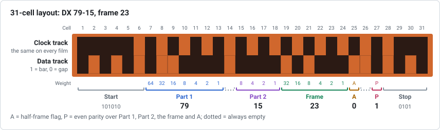
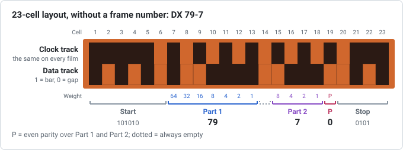

# 01 – The DX edge code format

**Question:** exactly how is information laid out in the DX barcode on the edge
of 35 mm film, and how sure can we be of each detail?

**Answer in short:** two touching tracks of binary cells. The upper *clock
track* is a fixed timing pattern; the lower *data track* carries a fixed start
pattern, Part 1 (7 bits), an empty cell, Part 2 (4 bits), a frame number
(6 bits), a half-frame flag, an empty cell, an even-parity bit and a fixed stop
pattern: 31 cells in all. Film made before the frame-number extension uses a
23-cell version without the frame fields. Every rule below is supported by at
least two independent sources and was confirmed on a real negative.

## Two tracks

The code sits between the sprocket holes and the edge of the film; its exact
position and size are in [report 05](05-reading-real-film.md). It has two rows
of equal height that touch, so a clock bar and a data bar in the same column
look like one tall bar:

- the **clock track**, nearer the sprocket holes, is the same on every film. It
  tells a reader where each cell is and which way the code runs;
- the **data track**, along the film edge, carries the information. Each cell
  is a bar (exposed, 1) or a gap (unexposed, 0).

Kodak's patent US 4,965,628 describes "a clock track 500 and a data track 505
extending parallel with the clock track", and Wikipedia's *DX number* article
places the clock track "closer to the sprocket holes".

## The 31-cell layout (with frame number)

Cells are numbered from 1 in reading order, starting at the wide clock mark.

| Cells | Field | Bits | Contents |
|---|---|---|---|
| 1–6 | Start | 6 | always `101010` |
| 7–13 | Part 1, "film product class" | 7 | binary, weights 64 32 16 8 4 2 1 |
| 14 | unassigned | 1 | always 0 |
| 15–18 | Part 2, "film specifier" | 4 | binary, weights 8 4 2 1 |
| 19–24 | Frame number | 6 | binary, weights 32 … 1 (see [report 02](02-frame-numbers.md)) |
| 25 | Half-frame flag | 1 | 1 = the "A" position between two frames |
| 26 | unassigned | 1 | always 0 |
| 27 | Parity | 1 | even parity over cells 7–13, 15–25 |
| 28–31 | Stop | 4 | always `0101` |

Clock track: `1111101010101010101010101010111`: a 5-cell mark, then 23 single
cells alternating gap/bar (11 thin bars), then a 3-cell mark.

Wikipedia's *DX number* article lists the same fields with section numbers of
ISO 1007 (§6.1.1.1 entry code to §6.1.1.8 exit code). Wikipedia's *DX
encoding* article describes the frame and half-frame bits together as "a
seven-bit frame/half-frame number", which matches the Kodak patent's
"seven bits defining the frame number … defined as half frame intervals".

## The 23-cell layout (no frame number)

The original 1983 code has no frame fields:

| Cells | Field |
|---|---|
| 1–6 | Start `101010` |
| 7–13 | Part 1 |
| 14 | unassigned, 0 |
| 15–18 | Part 2 |
| 19 | Parity |
| 20–23 | Stop `0101` |

Clock track: `11111010101010101010111`: a 5-cell mark, 15 single cells
(7 thin bars), a 3-cell mark.

Evidence: zxing-cpp's reader and Zint's generator both implement this version
(clock run widths `5, 1×15, 3` against `5, 1×23, 3` for the long one), Fuji's
patent US 5,122,645 describes a DX code with "seven clock bars", Aurélien
Lawley distinguishes a "short version" from a "long version", and Antoine
Mérino's blog shows a roll whose code (DX 40-9, a Konica number) carries no
frame number. In practice: **11 thin clock bars mean the 31-cell layout, 7 mean
the 23-cell one.**

The 23-cell code did not disappear with the 1990 extension. A Kodak patent
filed in 1995 (US 5,665,950) still describes existing readers as "designed to
read a 23-bit, two track DX bar code", and a Kodak patent filed in 1997
(EP 0838718) notes "a substantial usage of DX coded film" without frame-number
codes. Which manufacturers used which layout, and until when, was not found;
see [report 07](07-history-and-related-markings.md) for the timeline.

### Telling the layouts apart needs the clock track

A finding of this project, checked exhaustively in the unit tests: a 23-cell
code entered into a 31-cell grid (its 23 cells, then empty cells) is *always*
a valid 31-cell code of the same film, at whole frame 10 or 42. The short
code's parity cell and stop pattern `0101` land in the frame field, giving
frame 10 when its parity cell is empty and 42 when it holds a bar. The frame
field then adds that parity bar (which already makes Part 1 + Part 2 even) plus
two more bars, so the payload stays even and the empty long parity cell is
exactly right. So the data track alone cannot reveal the layout; the clock
track can, and so can the code's length relative to the perforations. The tool
therefore asks users to count the thin bars, and when it sees this signature
in the 31-cell strip it asks whether the top row has 7 thin bars. The photo
reader is not affected: it matches the whole clock pattern, and neither clock
pattern fits inside the other.

## Bit order

All numbers are written most significant bit first in reading order.
Wikipedia's sample encodes 79 as `1001111` in cells 7–13; Lawley gives the
weights 64 … 1 for cells 7–13 and 8 … 1 for cells 15–18; zxing-cpp reads fields
with `ToInt` from the lowest index up; Zint writes them with
`z_bin_append_posn`, which appends the most significant bit first.

## Parity

The parity cell holds a bar exactly when the 18 payload bits (Part 1, Part 2,
frame number, half-frame flag) contain an odd number of bars, so payload plus
parity is always even. The sources phrase this differently but agree:

| Source | How it is expressed |
|---|---|
| zxing-cpp | parity bit must equal the sum of all data bits before it, modulo 2 (the empty cells are 0 and do not change the sum) |
| Zint | parity = XOR of every bit after the start pattern |
| alibosworth | "even parity over the 18 useful data bits" |
| Mérino | parity 1 means "the sum of the previous bits should be odd" |
| Wikipedia sample | 79-15 frame 23 has 13 payload bars and the parity cell set |

Wikipedia's explanatory sentence ("positions 1 through 12 plus the parity bit")
does not match its own table; the table is consistent with the rule above, so
the sentence was treated as a wording slip.

## Start and stop: two equivalent descriptions

Wikipedia and Zint describe a 6-bit start `101010` and a 4-bit stop `0101`.
zxing-cpp treats the start as `10101` followed by a data bit that is always 0,
and the stop as `101` preceded by a bit that is always 0. Both describe the same
31 cells; the empty cells 6 and 28 separate the end marks of the clock track
from the data area so that a 1 in cell 7 or cell 27 cannot merge with them.

## Worked examples

Fields separated by spaces, in the order of the tables above.

| DX number, frame | Data track | Source |
|---|---|---|
| 79-15, 23 | `101010 1001111 0 1111 010111 0 0 1 0101` | Wikipedia sample; also measured from a real Kodak BW400CN negative ([report 05](05-reading-real-film.md)) |
| 95-14, 5 | `101010 1011111 0 1110 000101 0 0 1 0101` | alibosworth's Portra 160 example |
| 112-1, 10A | `101010 1110000 0 0001 001010 1 0 1 0101` | Mérino's example |
| 47-1, 22A | `101010 0101111 0 0001 010110 1 0 0 0101` | Wikimedia photo caption (Perutz Primera 200) |
| 127-15, 63A | `101010 1111111 0 1111 111111 1 0 0 0101` | Zint test vector (largest values) |
| 79-7, no frame | `101010 1001111 0 0111 0 0101` | Zint test vector (23-cell layout) |

All of these, plus every other Zint test vector, are part of the project's unit
tests (`tests/unit/codec.test.mjs`), together with an exhaustive round trip of
all 2,032 possible DX numbers.

## Rules the decoder enforces

| Check | Why |
|---|---|
| Start and stop patterns | fixed by the format (the tool draws them, but photos are checked) |
| Cells 14 and 26 empty | "unassigned … left blank" (ISO 1007 via Wikipedia); zxing-cpp rejects codes that break this |
| Parity | as above |
| Part 1 ≠ 0 | zxing-cpp rejects product number 0, and the 2008 I3A list leaves 0 unassigned |

When parity fails, one bar has most likely been misread. Because a single
parity bit cannot say which, the tool lists every single-cell change that
produces a valid code and puts those that match a known film first.

## Names for the fields

| This project | Kodak patent | ISO 1007 via Wikipedia | Other names |
|---|---|---|---|
| Part 1 | product code; "film product class" in FIG. 5 | film product class identification | ProdCode (Pakon scanners), DXN1 |
| Part 2 | generation number; "film specifier" in FIG. 5 | film specifier | GenCode, DXN2 |
| Part 1-Part 2 | NAPM number | DX number | DX number |
| 31-cell code with frame number | multi-field bar code | — | "DXN code" (Kodak's EP 0838718) |
| Frame field + half-frame flag | frame number in half-frame intervals | frame number and half-frame indicator | "DXN" number (Wikipedia, *DX encoding*) |

Note that Mérino's "DXN1" and "DXN2" mean Part 1 and Part 2, while "DXN" in
Kodak's and Wikipedia's usage refers to the frame-number extension.

## Software that reads or writes the code

- **zxing-cpp** (reader) reports a code as text such as `115-10/11A`:
  Part 1, Part 2 and, for the 31-cell layout, the frame label after a slash.
  This project's shareable links use the same form (`?dx=79-15/23`). It
  rejects codes whose unused cells hold a bar, whose parity fails or whose
  Part 1 is 0, and accepts runs of up to 20 equal cells, the longest possible
  in a valid data track (for example `96-0/0`).
- **Zint** (generator) accepts the same text form, a four-digit "DX extract"
  (16 × Part 1 + Part 2, 16 to 2047) or a six-digit "DX full" cassette number,
  and the frame labels `X`/`S` (62), `00`/`K` (63) and `F` (0).
- The modified Big Film Database website scans DX edge codes and cassette
  barcodes with a phone camera using zxing-cpp
  ([report 04](04-community-database.md)).

## Sources

All sources named above are listed in [report 06](06-sources-and-licensing.md#sources).
