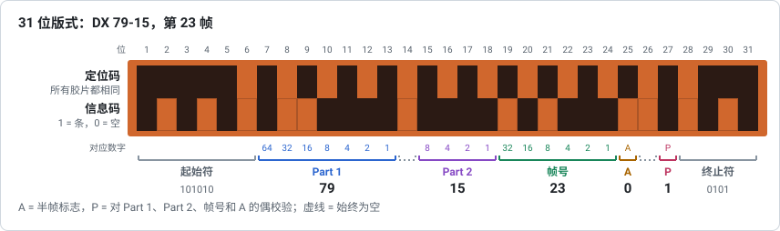
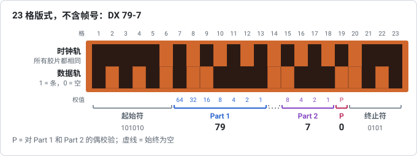

# 01 – DX 潜影条码格式

**问题**：135 规格胶片片边上的 DX 条码中，信息究竟是怎样排列的？每个细节我们能有多大把握？

**简短回答**：条码由相互紧贴的两道组成，每道都是一串二进制单元。上面的*时钟道*是固定的定时图案；下面的*数据道*带有固定的输入模式、第 1 部分（7 位）、一个未指定位、第 2 部分（4 位）、画幅号（6 位）、半画幅标志、一个未指定位、一个奇偶检验位和固定的输出模式，共 31 位。画幅号扩展出现之前生产的胶片使用 23 位的版本，没有画幅号识别行。下文的每条规则都在 GB/T 9185-2003（等同采用 ISO 1007:2000 的中国国家标准）中有规定，另有至少两个相互独立的来源支持，并已在一张真实的负片上得到证实。

## 时钟道和数据道

条码位于片孔与胶片边缘之间；它的确切位置和尺寸见[报告 05](05-reading-real-film.zh-CN.md)。它有两道，彼此紧贴，所以同一列中时钟道的条和数据道的条看起来就像一根高条：

- **时钟道**靠近片孔，在所有胶片上都一样。它告诉条码读出器每个单元在哪里，以及条码的走向；
- **数据道**沿着胶片边缘，承载信息。每个单元要么是条（曝光单元，1），要么是空（未曝光单元，0）。

柯达的专利 US 4,965,628 描述了“a clock track 500 and a data track 505 extending parallel with the clock track”（时钟道 500，以及与时钟道平行延伸的数据道 505），维基百科的 *DX number* 条目则把时钟道放在“closer to the sprocket holes”（更靠近片孔）的位置。GB/T 9185-2003 同样把条码分成这两道；它的测量方法在距片边 0.41 mm 处扫描数据道，在距片边 1.63 mm 处扫描时钟道（附录 B.2）。时钟道上密度的每次变化标出数据道中一位的位置（§7.2.2），数据道中条的边缘应与时钟道中条的边缘对齐（表 1 注 12）。

## 31 位条码（带画幅号）

各单元按读取顺序从 1 开始编号，起点在时钟道的宽标记处。

| 位 | 字段 | 位数 | 内容 |
|---|---|---|---|
| 1–6 | 输入模式 | 6 | 总是 `101010` |
| 7–13 | 第 1 部分，“film product class”（胶片产品类别） | 7 | 二进制，对应数字 64 32 16 8 4 2 1 |
| 14 | 未指定位 | 1 | 总是 0 |
| 15–18 | 第 2 部分，“film specifier”（胶片规格号） | 4 | 二进制，对应数字 8 4 2 1 |
| 19–24 | 画幅号 | 6 | 二进制，对应数字 32 … 1（见[报告 02](02-frame-numbers.zh-CN.md)） |
| 25 | 半画幅标志 | 1 | 1 = 两个画幅之间的“A”位置 |
| 26 | 未指定位 | 1 | 总是 0 |
| 27 | 奇偶检验位 | 1 | 使第 7–13、15–25 位的条数加上它为偶数 |
| 28–31 | 输出模式 | 4 | 总是 `0101` |

时钟道：`1111101010101010101010101010111`，即先是一个占 5 位的标记，然后是 23 个空/条交替的单元（11 根细条），最后是一个占 3 位的标记。

GB/T 9185-2003 逐一规定了这些字段，从输入模式（§7.2.1.1）到输出模式（§7.2.1.8），并在图 1f 中画出了一个 31 位条码。其中的细节与上表一致：输入模式的最后一位总是空；第 1 部分是第 7–13 位，第 2 部分是第 15–18 位，都以第一位为最大的二进制位；画幅号识别行是第 19–25 位，第 25 位有条就是半画幅“标志”；第 14 位和第 26 位是未指定位，总是空，第 26 位只在有画幅号识别行时才有。维基百科的 *DX number* 条目列出了同样的字段，章节号为 §6.1.1.1 entry code（输入码）到 §6.1.1.8 exit code（输出码）。维基百科的 *DX encoding* 条目把画幅号位和半画幅位合起来描述为“a seven-bit frame/half-frame number”（一个 7 位的画幅/半画幅号），这与柯达专利中的“seven bits defining the frame number … defined as half frame intervals”（定义画幅号的 7 位……以半画幅间隔定义）以及该标准 7 位的画幅号识别行一致。

## 23 位条码（无画幅号）

1983 年最初的条码没有画幅号识别行：

| 位 | 字段 |
|---|---|
| 1–6 | 输入模式 `101010` |
| 7–13 | 第 1 部分 |
| 14 | 未指定位，0 |
| 15–18 | 第 2 部分 |
| 19 | 奇偶检验位 |
| 20–23 | 输出模式 `0101` |

时钟道：`11111010101010101010111`，即一个占 5 位的标记、15 个空/条交替的单元（7 根细条）、一个占 3 位的标记。

GB/T 9185-2003 仍把这种 23 位条码规定为基本条码，即用来识别制造厂和胶片的条码（§7.1），并在图 1e 中画出了它；画幅号是再增加 8 位的可选扩展。图 1e 中第 1 部分和第 2 部分的标注互换了；正文（§7.2.1.2、§7.2.1.4）和图 1f 中两者的位置与上表相同。

证据：zxing-cpp 的条码读出器和 Zint 的生成器都实现了这个版本（时钟道各连续段的宽度为 `5, 1×15, 3`，长版本则为 `5, 1×23, 3`）；富士的专利 US 5,122,645 描述了一种带有“seven clock bars”（时钟道的 7 根条）的潜影条码；Aurélien Lawley 区分了“short version”（短版本）和“long version”（长版本）；Antoine Mérino 的博客展示了一卷胶卷，它的条码（DX 40-9，柯尼卡的一个 DX 码）不带画幅号。实践中：**时钟道有 11 根细条表示 31 位条码，有 7 根表示 23 位条码。**

23 位条码并没有随着 1990 年的扩展而消失。柯达 1995 年申请的一项专利（US 5,665,950）仍把现有的条码读出器描述为“designed to read a 23-bit, two track DX bar code”（设计用于读取 23 位、双道的 DX 条码）；柯达 1997 年申请的一项专利（EP 0838718）提到，有“a substantial usage of DX coded film”（大量 DX 编码胶片）不带画幅号编码。哪些制造厂用了哪种条码、一直用到什么时候，都没有查到；时间线见[报告 07](07-history-and-related-markings.zh-CN.md)。

### 区分两种条码要靠时钟道

这是本项目的一个发现，已在单元测试中穷举验证：把 23 位条码填进 31 位的网格（先是它的 23 位，后面都是空），得到的*总是*同一胶片的一个有效 31 位编码，画幅号为 10 或 42，且为全画幅位置。短条码的奇偶检验位和输出模式 `0101` 落进了画幅号识别行：奇偶检验位为空时得到画幅 10，有条时得到画幅 42。这样，画幅号识别行贡献的是那根奇偶检验位的条（它本来就使第 1 部分 + 第 2 部分的条数成为偶数）再加两根条，所以数据位的条数仍是偶数，长条码中空着的奇偶检验位恰好正确。因此，仅凭数据道看不出是哪种条码；时钟道可以，条码相对于片孔的长度也可以。所以本工具请用户数细条，并且当它在 31 位片条中看到这种特征时，会询问时钟道是否有 7 根细条。照片读取不受影响：它匹配的是完整的时钟道图案，而两种时钟道图案互不包含。

## 位序

所有数值都按读取顺序、最大的二进制位在前写入。GB/T 9185-2003 举了一个例子：第 1 部分 = 41 在第 8、10、13 位有条（§7.2.1.2）。维基百科的示例在第 7–13 位中把 79 编码为 `1001111`；Lawley 给出的对应数字是第 7–13 位为 64 … 1、第 15–18 位为 8 … 1；zxing-cpp 用 `ToInt` 从最低索引开始往上读取字段；Zint 用 `z_bin_append_posn` 写入字段，这个函数先追加最大的二进制位。

## 奇偶检验

当且仅当 18 个数据位（第 1 部分、第 2 部分、画幅号、半画幅标志）中有奇数根条时，奇偶检验位才有条，所以数据位加上奇偶检验位的条数总是偶数。各来源的说法不同，但意思一致：

| 来源 | 表述方式 |
|---|---|
| GB/T 9185-2003 | 数据位中的条加上奇偶检验位，总数应为偶数；未指定位也算在内，但它们总是空，不影响条数（§7.2.1.7） |
| zxing-cpp | 奇偶检验位必须等于它之前所有数据位之和对 2 取模的结果（未指定位为 0，不改变这个和） |
| Zint | 奇偶检验位 = 输入模式之后每一位的异或 |
| alibosworth | “even parity over the 18 useful data bits”（对 18 个有用数据位做奇偶检验，结果为偶数） |
| Mérino | 奇偶检验位为 1 表示“the sum of the previous bits should be odd”（前面各位之和应为奇数） |
| 维基百科示例 | 79-15 的画幅 23 的数据位中有 13 根条，奇偶检验位有条 |

维基百科里的说明句（“positions 1 through 12 plus the parity bit”，意为第 1 到第 12 位加上奇偶检验位）与它自己的表格不符。该标准把这条规则写了两遍：23 位条码对第 7–18 位（共 12 位）检验，带画幅号识别行时对第 7–25 位检验（§7.2.1.7）。维基百科的这句话符合前者；它的表格是一个 31 位条码，符合后者。

## 输入模式和输出模式：两种等价的描述

GB/T 9185-2003 规定了 6 位的输入模式，最后一位总是空（§7.2.1.1），以及 4 位的输出模式（§7.2.1.8）；条码读出器用它们找到条码的开始和结束，图 1e 和 1f 中它们是 `101010` 和 `0101`。维基百科和 Zint 描述的也是 6 位的输入模式和 4 位的输出模式。zxing-cpp 则把输入模式看作 `10101` 后面跟一个总是 0 的数据位，把输出模式看作 `101` 前面有一个总是 0 的位。两种描述对应的是同样的 31 位；空着的第 6 位和第 28 位把时钟道两端的标记与数据位隔开，使第 7 位或第 27 位中的 1 不会与它们连在一起。

## 示例

各字段之间用空格隔开，顺序与上面的表格相同。

| DX 码，画幅 | 数据道 | 来源 |
|---|---|---|
| 79-15, 23 | `101010 1001111 0 1111 010111 0 0 1 0101` | 维基百科示例；也从一张真实的柯达 BW400CN 负片上测得（[报告 05](05-reading-real-film.zh-CN.md)） |
| 95-14, 5 | `101010 1011111 0 1110 000101 0 0 1 0101` | alibosworth 的 Portra 160 示例 |
| 112-1, 10A | `101010 1110000 0 0001 001010 1 0 1 0101` | Mérino 的示例 |
| 47-1, 22A | `101010 0101111 0 0001 010110 1 0 0 0101` | 维基共享资源上的照片说明（Perutz Primera 200） |
| 127-15, 63A | `101010 1111111 0 1111 111111 1 0 0 0101` | Zint 测试向量（最大值） |
| 79-7，无画幅号 | `101010 1001111 0 0111 0 0101` | Zint 测试向量（23 位条码） |

以上所有示例，加上 Zint 的其他所有测试向量，都是本项目单元测试（`tests/unit/codec.test.mjs`）的一部分，此外还有对全部 2,048 个可能的 DX 码的穷举往返测试。

## 解码器执行的规则

| 检查项 | 原因 |
|---|---|
| 输入模式和输出模式 | 由格式规定（本工具会画出它们，但读取照片时会检查） |
| 第 14 位和第 26 位为空 | 未指定位，总是空（GB/T 9185-2003，§7.2.1.3 和 §7.2.1.6；维基百科转引 ISO 1007 为“unassigned … left blank”（未指定……留空））；zxing-cpp 会拒绝违反这一点的条码 |
| 奇偶检验 | 见上文 |

解码器接受第 1 部分 = 0，因为该标准把它算作有效（表 3；附录 A.3.1），尽管 zxing-cpp 拒绝它，2008 年的 I3A 列表也没有分配它。

奇偶检验不通过时，最可能是有一根条读错了。由于单个奇偶检验位无法指出是哪一根，本工具会列出所有只改一位就能得到有效编码的改动，并把与已知胶片相符的列在前面。

## 字段的名称

| 本项目 | 柯达专利 | GB/T 9185-2003 | ISO 1007（经维基百科转引） | 其他名称 |
|---|---|---|---|---|
| 时钟道、数据道 | clock track、data track | 时钟道、数据道 | — | — |
| 输入模式、输出模式 | — | 输入模式、输出模式 | entry code（输入码）、exit code（输出码） | — |
| 第 1 部分 | product code（产品代码）；图 5 中为“film product class”（胶片产品类别） | DX 码第 1 部分 | film product class identification（胶片产品类别标识） | ProdCode（Pakon 扫描仪）、DXN1 |
| 第 2 部分 | generation number（代次号）；图 5 中为“film specifier”（胶片规格号） | DX 码第 2 部分 | film specifier（胶片规格号） | GenCode、DXN2 |
| 第 1 部分-第 2 部分 | NAPM number（NAPM 编号） | DX 码 | DX number（DX 码） | DX number |
| 带画幅号的 31 位条码 | multi-field bar code（多字段条码） | 带任选画幅号的潜影双道条码 | — | “DXN code”（柯达的 EP 0838718） |
| 画幅号识别行 | frame number in half-frame intervals（以半画幅为间隔的画幅号） | 画幅号识别行 | frame number and half-frame indicator（画幅号和半画幅指示符） | “DXN”编号（维基百科，*DX encoding*） |

注意，Mérino 所说的“DXN1”和“DXN2”指第 1 部分和第 2 部分，而柯达和维基百科用法中的“DXN”指的是画幅号扩展。

## 读写这种条码的软件

- **zxing-cpp**（条码读出器）把条码输出为 `115-10/11A` 这样的文本：第 1 部分、第 2 部分，对于 31 位条码，还有斜杠后面的画幅标签。本项目的可分享链接也用同样的形式（`?dx=79-15/23`）。zxing-cpp 会拒绝未指定位中有条、奇偶检验不通过或第 1 部分为 0 的条码，并接受最长 20 个相同位的连续段，这是有效数据道中可能出现的最长连续段（例如 `96-0/0`）。
- **Zint**（生成器）接受同样的文本形式、“DX extract”（四位数编号，16 × 第 1 部分 + 第 2 部分，16 到 2047）或“DX full”（六位数的暗盒条码数字），以及画幅标签 `X`/`S`（62）、`00`/`K`（63）和 `F`（0）。
- 修改版的 Big Film Database 网站借助 zxing-cpp，用手机摄像头扫描 DX 潜影条码和暗盒条码（[报告 04](04-community-database.zh-CN.md)）。

## 来源

上文提到的所有来源都列在[报告 06](06-sources-and-licensing.zh-CN.md#来源) 中。
