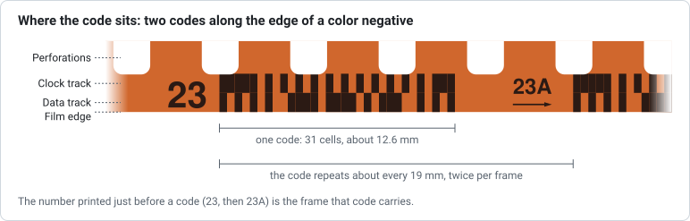

# 02 – Frame numbers

**Question:** what does the frame field of the 31-cell code hold, and how does
it relate to the numbers printed along the film?

**Answer in short:** the frame field and the half-frame flag together count
half-frame positions along the roll. The code is printed twice per frame, at
the frame (`23`) and halfway to the next (`23A`), and the number printed just
before each code names that code. The leader positions printed `XX`, `X` and
`00` are stored as 61, 62 and 63, counting down from 0, so the stored values run
61, 61A, 62, 62A, 63, 63A, 0, 0A, 1, 1A, … up to 60A.

## Why there are two codes per frame

Kodak's patent US 4,965,628 explains the design: photofinishing machines punch
a notch into the film edge at every frame, which can destroy a barcode. A code
short enough to fit twice per frame guarantees that "at least alternate ones of
the multi-field bar code images will always be readable", and missing ones "may
be reconstructed by interpolation". The patent describes the frame field as
"seven bits defining the frame number … defined as half frame intervals", so a
36-exposure roll has 72 frame numbers.

The repetition matches the film geometry: a 35 mm frame advances 8
perforations of 4.75 mm, 38 mm, and the code repeats about every 19 mm
(alibosworth's format reference). GB/T 9185-2003 gives the exact numbers:
frames are 38 mm apart and half frames 19 mm (Table 1, Y15 and Y16), the
half-frame numbers 1, 1A, 2, 2A … 36, 36A are printed every four perforations
along the edge that carries the DX code, and a code sits next to each of them
(§6, §7.1).

Kodak's EP 0838718 describes how printers used this: Kodak's CLAS35 printer
read one frame number as a reference and used the fixed pitch between codes to
work out the frame number at every frame notch, so each print could carry its
frame number. The alternative, a separate frame-number barcode on the opposite
edge, was used by Fuji in the late 1980s and became an option in ISO 1007:2000
([report 07](07-history-and-related-markings.md)).

## What is printed around the codes

Per the patent (FIG. 4), successive codes within a frame are separated by an
orientation arrow and the half-frame number, and codes in adjacent frames by
the full frame number. Two photos confirm the order on real film, with the
label *before* the code it names:

| Photo | What is visible along the edge, left to right |
|---|---|
| Wikimedia, *Dx-film-edge-barcode.jpg* (Agfa, DX 47-1) | `▶22A`, the code for 22A, `23`, … |
| Wikimedia, *Kodak Telegraph negativ23a.jpg* (Kodak BW400CN) | `23`, the code for 23 (measured, see [report 05](05-reading-real-film.md)), `23A` with an arrow, … |

So when a user reads a code, the printed number just to its left should match
the decoded frame. The tool says so under the strip and draws that number
before the code, at its size on the Kodak negative
([report 05](05-reading-real-film.md#validation-decoding-a-real-negative)).

The standard adds that a second row of numbers may run along the opposite
edge: whole-frame numbers 1, 2 … 36 every eight perforations, or half-frame
numbers as part of the optional single-track frame-number barcode (§6;
[report 07](07-history-and-related-markings.md#fujis-frame-number-barcode)).

## The leader: XX, X, 00 and 0

Before frame 1, rolls carry a few extra positions that are normally lost when
the film is loaded. GB/T 9185-2003 calls frame 1 the first designated number
(Figure 1a) and finds the frame numbers before 0 by counting down in binary
(§7.2.1.5). Its Table 5 therefore lists 00 as 63, X as 62 and XX as 61, each
with an A position; the standard writes these labels as × and ××.

- alibosworth records the printed sequence on Kodak rolls as
  `X, XA, 00, 00A, 0, 0A, 1, 1A, …` (without having verified the bit values).
- Antoine Mérino decoded four consecutive codes on a 1998 Kodak roll (DX 79-2)
  as 62A, 63, 63A, 0.
- Zint's generator accepts the labels `X` or `S` for 62, `00` or `K` for 63 and
  `F` for 0, and its manual states the same.

Together: **XX = 61, X = 62, 00 = 63**, and the 6-bit field wraps from 63
to 0. Ordinary frame numbers run from 1 to 60: Table 5 ends at 60A, and gives
the numbers beyond 36A, the longest standard roll, for possible future use
(§7.2.1.5). The alternative labels S, K and F are
documented only by Zint; which films print them was not found, so the tool
mentions them as "also printed as" without attributing them to a maker.

| Printed | Frame field | Half-frame flag |
|---|---|---|
| XX / XXA | 61 | 0 / 1 |
| X / XA | 62 | 0 / 1 |
| 00 / 00A | 63 | 0 / 1 |
| 0 / 0A | 0 | 0 / 1 |
| 1 … 60 (and A) | same number | 0 / 1 |

## Edge numbers are not camera frames

The edge code is exposed at the factory at a fixed pitch; pictures are
exposed later wherever the camera puts them. alibosworth points out that the
two are not phase-locked: a picture may sit on an `N`/`NA` pair, straddle `5A`
and `6`, or anything in between. The edge number therefore tells you roughly
where along the roll a picture is, which is enough to put frames in order, but
it need not equal the camera's frame counter.

## Half-frame cameras

Half-frame cameras expose two 18 × 24 mm pictures per 38 mm, about one per
code. Mérino suggests counting positions instead of frames: 0, 0A, 1, 1A, …
become half frames 0, 1, 2, 3, …, that is 2 × frame + flag. Kodak's printers
used the same numbering internally: in EP 0838718, half frame 22 becomes
decimal 44 and 22A becomes 45. The tool shows this "half-frame count" for
frames 0–60 and leaves it out for XX, X and 00.

## Short codes

The 23-cell layout has no frame field at all (see [report 01](01-edge-code-format.md)).
Film with short codes still has printed frame numbers, but they cannot be read
from the barcode, so the tool shows no frame for it, and its strip leaves out
the room for the printed number.

## Sources

All sources named above are listed in [report 06](06-sources-and-licensing.md#sources).
