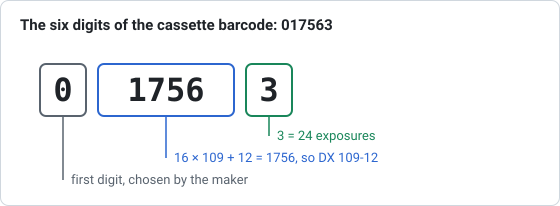

# 03 – DX numbers and the registry

**Question:** what do Part 1 and Part 2 identify, who assigned them, and which
list of assignments can the tool rely on?

**Answer in short:** Part 1 identifies a manufacturer's product class and was
assigned centrally; Part 2 distinguishes that manufacturer's products. The most
recent assignment list that is freely available is I3A's *DX Codes for
135-Size Film* of February 2008. It was transcribed into
`data/i3a-2008/` with two independent parsers and checked against itself.

## The DX number

A DX number is written `Part 1-Part 2`, for example `79-15`. Part 1 has 7 bits
(0–127, with 0 unused) and Part 2 has 4 bits (0–15), so there are 2,032 possible
numbers. The number names a film product; it does not encode speed or process,
which follow from the product (alibosworth; Wikipedia *DX number*).

The same number is used on the cassette, where its middle four digits are
16 × Part 1 + Part 2 (see below). Kodak's 1990 patent calls the pair the
"NAPM number" after the National Association of Photographic Manufacturers,
which first allocated Part 1 numbers. The task later passed to PIMA and then to
I3A (alibosworth's summary of the lineage); Wikipedia states that I3A
"published and sold a proprietary list of DX numbers … yearly or as needed",
the last edition dated January 2009. That edition was not found online. The Big
Film Database mentions DX codes for 2011–2014 obtained from the Society for
Imaging Science and Technology (IS&T), which have not been published.

## The February 2008 list

The document has two parts.

**Part 1 assignment table (0–127).** 91 numbers are assigned to 12
"sensitizers" (manufacturers); 9 of them are marked "APS Film" (33, 37, 38, 44,
45, 72, 86, 91, 94). A note lists numbers assigned in the past: 21 and 22 to
Tudor in 1989 (never renewed), 65 to 3M (1985–1993), 119 to ORWO (1988–1993),
and 96 to Eastman Kodak (1983, released 1988, reassigned 2003).

| Assignee (as in the table) | Part 1 numbers | Product rows |
|---|---|---|
| Agfa-Gevaert | 14 | 99 |
| China Lucky Film | 3 | 10 |
| Eastman Kodak | 30 | 91 |
| ERA Photo | 1 | 1 |
| Ferrania Imaging | 7 | 23 |
| FUJIFILM Corporation | 12 | 74 |
| Harman Technologies (ILFORD Photo) | 6 | 29 |
| KONICA MINOLTA | 11 | 39 |
| ORWO Media | 4 | 12 |
| Shanghai General Photo | 1 | 4 |
| SVEMA Production | 1 | 1 |
| Xiamen FUDA | 1 | 3 |

**Product listing.** For each sensitizer, rows of Part 1, Part 2 and product
name. Agfa-Gevaert, Eastman Kodak and Konica Minolta split their rows into
"DX numbers that are currently being used" and films "no longer manufactured …
but which may still be in the marketplace"; the tool shows this as "in
production in 2008" or "discontinued by 2008". In total 389 rows are printed.

### Quirks found in the document

- The summary page counts 28 Part 1 numbers for Eastman Kodak but lists 30;
  the per-number table also has 30.
- Three Agfa rows (Part 1 17, Part 2 2) are printed twice; the tool keeps one
  of each, leaving 386 rows.
- Shanghai General's four brands (Shenguang, Shanghai, Seagull, Rainbow) are
  listed with Part 2 "not identified", so they match any Part 2 under 88.
- Ferrania's Part 2 numbers are printed with leading zeros (`01` … `10`).
- 17 DX numbers are shared by two or more products, e.g. `3-9` by five
  Agfachrome and Perutz slide films, and `95-2` by Kodak High Definition 400
  and Kodak Hawkeye Traffic Surveillance film. The tool shows all of them.
- Harman Technologies is not named as ILFORD in the list; its products (HP5
  PLUS, FP4 PLUS, DELTA …) are ILFORD films, and Wikipedia's table labels these
  numbers "Ilford Photo", so the tool adds that name in brackets.

### How the list was transcribed

1. The PDF's text layer was read with word coordinates (PyMuPDF), so table
   rows could be rebuilt from their positions and product names that wrap onto
   a second line joined back together.
2. A second, independent parser worked on the plain text stream. Both produced
   the same 389 rows.
3. The Part 1 table was compared with the document's own *Assignment Summary*
   page: identical for all 12 assignees.
4. Pages were rendered to images and compared by eye with the extracted rows.
5. Spot checks against published examples: 34-6 is FUJICHROME ASTIA 100
   PROFESSIONAL (Lawley), 115-3 and 115-4 are Perutz SC 100-3 and 200-3 Color
   (Wikipedia), 79-15 is KODAK Professional BW400CN Film (Wikipedia sample).

`scripts/extract-i3a-pdf.py` reproduces the transcription from a copy of the
PDF; the unit tests in `tests/unit/data.test.mjs` repeat the consistency checks
on the CSV files.

## The cassette barcode

The 35 mm cassette carries an Interleaved 2 of 5 barcode with six printed
digits, `PHHHHE` (Wikipedia *DX number*; Kodak US 5,761,558):

| Digit | Meaning |
|---|---|
| P | chosen by the manufacturer, 0–9 |
| HHHH | 16 × Part 1 + Part 2, e.g. 79-15 → `1279` |
| E | number of exposures: 1 = 12, 2 = 20, 3 = 24, 4 = 36, 5 = 48, 6 = 60, 0 = 72, 7 = other lengths such as 24 + 3 (ANSI/NAPM IT1.14:1994 as quoted by Wikipedia) |

Worked examples: `315223` → 95-2, 24 exposures (Wikipedia); `017563` → 109-12,
24 exposures (Wikipedia's photo of an ISO 125 cassette, and 109-12 is FP4 PLUS
in the I3A list); `412503` → 78-2 (Mérino); Kodak's patent computes 83-2 →
1330. Digits 8 and 9 as E are not defined in the sources, and the tool says so.

The largest real DX number gives HHHH = 2047. The I3A list also records five
Kodak "augmented magazine bar code numbers" (ISO 1007, Annex A.4) for Kodak
films sold through Jean Coutu pharmacies in Canada, for example `832973`; their
middle digits exceed 2047, so they cannot appear on the film edge. The
cassette helper recognises them by their full number.

Wikipedia cites the cartridge barcode patent with the right title, inventors
and dates but the number "US 5661558A", which belongs to an unrelated patent
(an optical detector for flowing samples). The correct number is US 5,761,558,
as Mérino cites.

## After 2008

Films introduced after the list (for example Kodak Portra 400 of 2010 or
Ektar 100 of 2008) are absent from it. Their codes are known only from
community sources, see [report 04](04-community-database.md).

## Sources

All sources named above are listed in [report 06](06-sources-and-licensing.md#sources).
