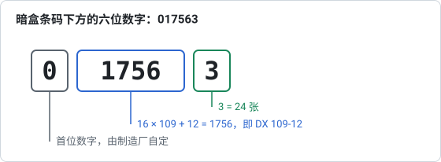

# 03 – DX 码与年度报告

**问题**：第 1 部分和第 2 部分标识的是什么，由谁分配，本工具可以依据哪一份分配列表？

**简短回答**：第 1 部分标识一家感光厂，是统一分配的；第 2 部分区分这家感光厂的各个产品。等同采用 ISO 1007:2000 的中国国家标准 GB/T 9185-2003 说明了这些编号的分配方式。可以免费获取的最新一份分配列表，是 I3A 的 2008 年 2 月版 *DX Codes for 135-Size Film*。这份列表已用两个相互独立的解析器转录到 `data/i3a-2008/`，并与列表本身做了核对。

## DX 码

DX 码写作“第 1 部分-第 2 部分”，例如 `79-15`。第 1 部分有 7 位（0–127），第 2 部分有 4 位（0–15）。该标准把 0–127 都算作有效的第 1 部分编号（附录 A.3.1），所以共有 2,048 个可能的 DX 码；2008 年的列表没有分配 0。DX 码代表一种胶片产品；它的各位并不编码感光度或加工工艺，这些由产品决定（alibosworth；维基百科 *DX number*）。不过该标准把第 1 部分和加工工艺联系在一起：同一个第 1 部分编号下的所有胶片都应使用同样的加工方法，例如彩色负片、彩色反转片或黑白片（附录 A.3.3）。2008 年列表中的产品名称大多带有感光度，但并非全部。

暗盒上也使用同一个 DX 码，暗盒条码的中间四位为 16 × 第 1 部分 + 第 2 部分（见下文）。柯达 1990 年的专利把这对数字称为“NAPM number”（NAPM 编号），这个名称来自最早分配第 1 部分编号的 National Association of Photographic Manufacturers（全国摄影器材制造商协会）。这项工作后来先后移交给 PIMA 和 I3A（alibosworth 对这段沿革的总结）；维基百科称 I3A “published and sold a proprietary list of DX numbers … yearly or as needed”（每年或按需出版并出售一份专有的 DX 码列表），最后一版的日期为 2009 年 1 月。网上没有找到这一版。The Big Film Database 提到了从影像科学与技术学会（IS&T）获得的 2011–2014 年 DX 码，这些 DX 码尚未公开。

该标准的附录 A 说明了 2000 年时由 PIMA 主管的分配程序（A.3、A.5）。感光厂，即把乳剂涂布到片基上的制造厂（A.2.1.1），向 PIMA 书面申请第 1 部分编号，可以申请某个特定的编号，并须在颁布日期 36 个月后确认保留它。第 2 部分编号（0 到 15）由感光厂自己分配，每推出一种新产品，就把产品名称和编号报告给 PIMA；PIMA 发布年度报告，列出已分配的第 1 部分编号所占的比例、每家感光厂的名称，以及每个第 1 部分/第 2 部分组合及其产品名称。下文 2008 年列表的结构正是如此。整理厂，即对感光胶片进行各种操作、包括在 135 暗盒和胶片上附加 DX 码的公司，从感光厂取得 DX 码；PIMA 不给整理厂分配 DX 码（A.2.1.2、A.3.7）。几种产品只要加工工艺相同，就可以共用一个 DX 码（A.3.8）。

## 2008 年 2 月的列表

这份文件包括两项内容。

**第 1 部分分配表（0–127）**。有 91 个编号分配给了 12 家“sensitizers”（感光厂）；其中 9 个（33、37、38、44、45、72、86、91、94）标为“APS Film”（先进摄影系统胶片）。一条注释列出了过去分配过的编号：21 和 22 于 1989 年分配给 Tudor（从未续期），65 分配给 3M（1985–1993 年），119 分配给 ORWO（1988–1993 年），96 分配给 Eastman Kodak（1983 年分配，1988 年释放，2003 年重新分配）。

| 感光厂（按表中写法） | 第 1 部分编号数 | 产品行数 |
|---|---|---|
| Agfa-Gevaert | 14 | 99 |
| China Lucky Film | 3 | 10 |
| Eastman Kodak | 30 | 91 |
| ERA Photo | 1 | 1 |
| Ferrania Imaging | 7 | 23 |
| FUJIFILM Corporation | 12 | 74 |
| Harman Technologies (ILFORD Photo) | 6 | 29 |
| KONICA MINOLTA | 11 | 39 |
| ORWO Media | 4 | 12 |
| Shanghai General Photo | 1 | 4 |
| SVEMA Production | 1 | 1 |
| Xiamen FUDA | 1 | 3 |

**产品列表**。每家感光厂下有若干行，每行是第 1 部分、第 2 部分和产品名称。Agfa-Gevaert、Eastman Kodak 和 Konica Minolta 把各自的行分为两类：“DX numbers that are currently being used”（目前正在使用的 DX 码），以及“no longer manufactured … but which may still be in the marketplace”（已不再生产……但可能仍在市面上）的胶片；本工具把这一区分显示为“2008 年仍在生产”或“截至 2008 年已停产”。列表共印有 389 行。

### 文件中发现的不寻常之处

- 汇总页给出的 Eastman Kodak 的第 1 部分编号数是 28 个，但列出的是 30 个；按编号逐行列出的表里也是 30 个。
- 爱克发有三行（第 1 部分为 17，第 2 部分为 2）各印了两次；本工具每行只保留一份，剩下 386 行。
- Shanghai General 的四个品牌（Shenguang、Shanghai、Seagull、Rainbow）的第 2 部分标为“not identified”（未指明），因此在第 1 部分为 88 时，任何第 2 部分都与它们匹配。
- Ferrania 的第 2 部分编号印成带前导零的形式（`01` … `10`）。
- 有 16 个 DX 码由两个或更多产品共用，例如 `3-9` 由五种 Agfachrome 和 Perutz 反转片共用，`95-2` 由 Kodak High Definition 400 和 Kodak Hawkeye Traffic Surveillance 胶片共用，这是该标准允许的；Shanghai General 的四个品牌也共用第 1 部分 88。本工具会把它们全部显示出来。
- 列表中没有把 Harman Technologies 称为 ILFORD；它的产品（HP5 PLUS、FP4 PLUS、DELTA 等）都是 ILFORD 胶片，而且维基百科的表格把这些编号标为“Ilford Photo”，所以本工具在括号里加上了这个名称。

### 列表是如何转录的

1. PDF 的文本层是连同单词坐标一起读取的（PyMuPDF），因此可以根据位置重建表格的行，并把折到第二行的产品名称重新接起来。
2. 第二个独立的解析器处理的是纯文本流。两者得到了相同的 389 行。
3. 把第 1 部分表与文件自身的 *Assignment Summary* 页对照：12 家感光厂全部一致。
4. 把各页渲染成图像，用肉眼与提取出的行进行比对。
5. 用已公开的例子做抽查：34-6 是 FUJICHROME ASTIA 100 PROFESSIONAL（Lawley），115-3 和 115-4 是 Perutz SC 100-3 和 200-3 Color（维基百科），79-15 是 KODAK Professional BW400CN Film（维基百科示例）。

`scripts/extract-i3a-pdf.py` 可以从 PDF 的副本重新生成这份转录；`tests/unit/data.test.mjs` 中的单元测试会对 CSV 文件重复这些一致性检查。

## 暗盒条码

135 规格暗盒上有一个交叉二五条码（Interleaved 2 of 5），印有六位数字 `PHHHHE`（GB/T 9185-2003，§9；维基百科 *DX number*；柯达 US 5,761,558）。这些数字印在暗盒嘴和条码之间，居中对准条码（§9.1）：

| 数位 | 含义 |
|---|---|
| P | 供制造厂自行使用，不用时为 0（§9.3） |
| HHHH | 16 × 第 1 部分 + 第 2 部分，例如 79-15 → `1279` |
| E | 可拍摄画幅数，见下表 |

与 GB/T 9185-1996（即 1993 年草案）相比，ISO 1007:2000 修改了 E 位的含义，以容纳更多的胶片长度（GB/T 9185-2003 前言，第 e 项）：

| E | 维基百科引用的 ANSI/NAPM IT1.14:1994 | GB/T 9185-2003（ISO 1007:2000），表 9 |
|---|---|---|
| 0 | 72 | 1–8 |
| 1 | 12 | 12 |
| 2 | 20 | 18–23 |
| 3 | 24 | 24 |
| 4 | 36 | 36 |
| 5 | 48 | 9–11 |
| 6 | 60 | 13–17 |
| 7 | 其他长度，如 24 + 3 | 25–29 |
| 8 | — | 30–35 |
| 9 | — | 37 或更多 |

该标准提醒，37 张或更多的长胶卷可能不被一些胶片处理机接受。24 + 3 张（27 张）的胶卷在两种定义下都是 7。本工具给出 2000 年的定义，在与 1994 年的定义不同时，也给出 1994 年的定义。

计算示例：`315223` → 95-2，24 张（维基百科）；`017563` → 109-12，24 张（维基百科上一张 ISO 125 暗盒的照片，而 109-12 在 I3A 列表中是 FP4 PLUS）；`412503` → 78-2（Mérino）；柯达的专利算出 83-2 → 1330。

最大的 DX 码得出 HHHH = 2047。ISO 1007:2000 允许暗盒条码超出这个范围（附录 A.4）：感光厂可以在暗盒上给自己的第 1 部分编号加上 128、256 或 384，最大到 511，用来区分暗盒，而不改变潜影条码；例如第 1 部分为 83 时，暗盒上还可以用 211、339 和 467。这些编号须报告给 PIMA。I3A 列表记录了五个这样的“augmented magazine bar code numbers”（增补暗盒条码编号），用于通过加拿大 Jean Coutu 药店销售的柯达胶卷，五个都符合这条规则：`832973` 中的 3297 = 16 × 206 + 1，而 206 = 78 + 128，78 是柯达的第 1 部分编号之一；其余四个同样由 78 和 82 得出。它们的第 2 部分也与各自所指胶片的普通 DX 码相同（78-1 是 KODAK GOLD 100 Film，78-2 是 GOLD 200，82-3 是 MAX 400），但该标准对增补编号中的第 2 部分没有任何规定。因此，暗盒条码查询显示这个算式和持有基本第 1 部分编号的感光厂，对这五个编号还附上 I3A 列表中的条目，但不推算 DX 码。

维基百科引用这项暗盒条码专利时，标题、发明人和日期都正确，但专利号写成了“US 5661558A”，这个号码属于一项无关的专利（一种用于流动样品的光学检测器）。正确的号码是 US 5,761,558，与 Mérino 的引用一致。

## 2008 年以后

在这份列表之后推出的胶片（例如 2010 年的 Kodak Portra 400 或 2008 年的 Ektar 100）都不在列表中。它们的 DX 码只能从社区来源得知，见[报告 04](04-community-database.zh-CN.md)。

## 来源

上文提到的所有来源都列在[报告 06](06-sources-and-licensing.zh-CN.md#来源) 中。
