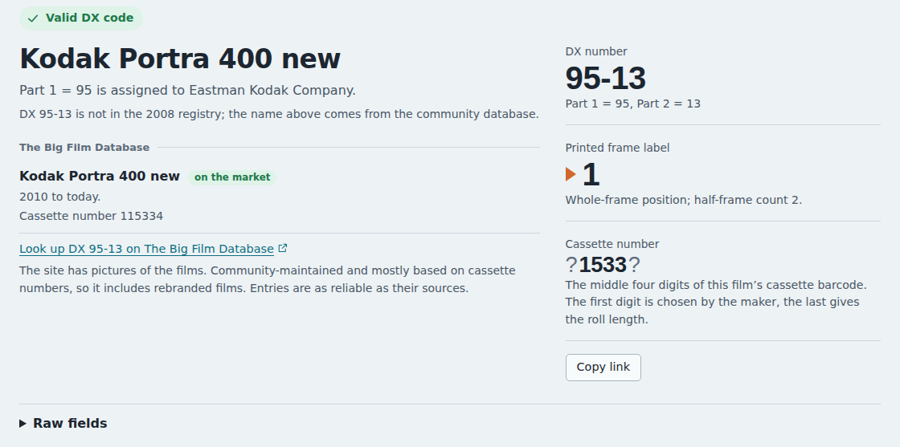

# 04 – The community film database

**Question:** can a community source fill the gap left by the 2008 registry,
and how far can it be trusted?

**Answer in short:** The Big Film Database covers 637 DX numbers that can
appear on a film edge, 277 of them absent from the 2008 registry, including
most films still sold today. It is openly licensed (CC BY-SA 4.0) and carries
its own certainty and availability fields, but it is built mostly from
cassettes and contains a few inconsistencies. The tool therefore shows it
separately from the registry, with its certainty, and never uses it to decide
the manufacturer behind a Part 1 number.

## What it is

The Big Film Database was started in February 2018 by its author, who
publishes as "Dxdatabase", as a website. In 2024 the data was released on
GitHub under CC BY-SA 4.0. The repository's README adds that the copyright of
the film box images belongs to their respective owners and that the images are
only available under "fair use". Antoine Mérino maintains a modified edition
with search by DX number and edge-barcode scanning. According to its help page, it was first compiled
from the I3A 2008 list and extended with DX codes for 2011–2014 obtained from
IS&T, Kodak's film chronology, Tom Philo's Kodak film-number cross-reference,
a Flickr thread on DX numbers, Wikipedia's film lists, collectors and
manufacturers' staff.

## The file

`film_database.csv` is a semicolon-separated CSV with standard double-quote
escaping, one row per product or packaging variant. Its columns are described
in [data/README.md](../data/README.md#big-film-database--community-data); the
meaning of the two coded ones, `reliability` (certainty, "4 = high, 0 = low")
and `Ava` (availability), comes from the site's own PHP code.

## Snapshot used

Commit `9aa3890` of the database's GitHub repository (October 10, 2026): 8,710
rows, of which 1,676 carry a DX number (1,674 with a DX extract, 2 with only a
cassette number, whose middle digits give the extract).
`npm run stats:community-data` prints these figures and those in the next
table; [data/README.md](../data/README.md#updating-the-data) describes how to
update the snapshot.

## Data-quality findings

| Finding | Rows | How the tool handles it |
|---|---|---|
| DX extract disagrees with the middle digits of the DX full number | 12 | uses the extract, as the site's own "similar emulsions" search does |
| Number above 2047, e.g. CineStill 50D and 800T cassettes at 5391 (cinema film, which has no DX edge code) | 42 | can match a cassette number, never an edge code |
| Number below 16, so Part 1 would be 0: valid under the standard, but held by no maker in 2008 | 14 | same |
| HTML markup inside a field (`<i>…</i>`) | 3 | markup removed |
| `#` search tags appended to the name | 441 | split off; still searchable |
| Certainty recorded | 502 (0: 5, 1: 44, 2: 79, 3: 289, 4: 85) | shown as "certainty n/4" |
| Availability | 1,465 discontinued, 121 unsure, 90 on the market | shown as a label |

Two structural limits matter more than any single row:

- **Cassette, not film.** Most numbers were read from cassettes. Rebranded
  films carry the brand's cassette, while the edge code is exposed by the
  factory that made the film. For the original manufacturers' own films the two
  agree; for rebrands they usually do, but nothing guarantees it. GB/T 9185-2003
  has companies that package another maker's film get their DX number from
  that maker rather than from PIMA (Annex A.3.7).
- **One number, many names.** A popular emulsion appears under every brand
  that sold it, so one code can list dozens of entries. The tool groups rows
  that differ only by cassette number and sorts the rest by name.

## Coverage of modern films

Spot checks of codes beyond the 2008 list:

| DX number | Community entry |
|---|---|
| 95-13 | Kodak Portra 400 new |
| 95-14 | Kodak Portra 160 (new), the same code alibosworth decoded from a physical strip |
| 95-11 | Kodak Ektar 100 |
| 95-15 | Kodak Ultra Max 400 |
| 110-10 | Kentmere 100 and Kentmere 400 (both listed under the same number) |
| 39-1 | in the registry as FUJICOLOR 200; the community adds many rebrands (AgfaPhoto Vista Plus 200, store brands) |

## How the tool presents it

- The registry and the community database are always labeled separately
  ("I3A registry, 2008" and "The Big Film Database").
- The title of a result comes from the registry when possible; the community
  name is used only when the registry has no entry, and the page then says so.
- The manufacturer of a Part 1 number always comes from the registry.
- A note under community matches explains that the data is community-maintained,
  mostly cassette-based and includes rebrands.
- Where the community database lists films for a DX number, the result and
  the cassette helper show one link to that number on Antoine Mérino's edition
  of the database, which has pictures of the films (for DX 96-12,
  `https://thebigfilmdatabase.merinorus.com/search?dx_number=96-12`). The
  pictures are not copied into this project.

The database's website also guesses a maker and film type from ranges of the
DX extract (the ranges are listed in its repository as
`Various documentation/Film type by DX.txt`). The site itself labels the guess
"not very accurate", and some ranges overlap: 46–127 is "Agfa Gevaert chrome
(slide) film" but also contains 64–79, "Kodak Technical film". The tool does
not use these ranges.

## Sources

All sources named above are listed in [report 06](06-sources-and-licensing.md#sources).
