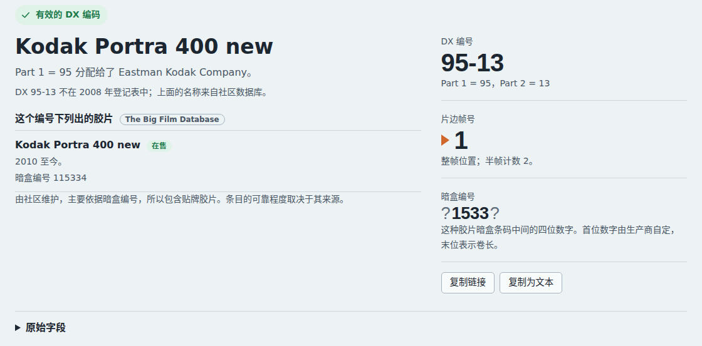

# 04 – 社区胶片数据库

**问题**：社区来源能否填补 2008 年登记表留下的空白，它在多大程度上可信？

**简短回答**：The Big Film Database 涵盖了 637 个可能出现在片边上的 DX 编号，其中 277 个不在 2008 年登记表中，包括如今仍在销售的大多数胶片。它采用开放许可证（CC BY-SA 4.0），自带可信度和供应情况字段，但它主要依据暗盒建立，并且有少量不一致之处。因此，本工具把它与登记表分开显示，并附上它的可信度，而且从不用它来判定某个 Part 1（第一部分）编号背后的生产商。

## 它是什么

The Big Film Database 由署名为“Dxdatabase”的作者于 2018 年 2 月以网站形式创办。2024 年，这些数据以 CC BY-SA 4.0 许可证在 GitHub 上发布。Antoine Mérino 维护着一个修改版，支持按 DX 编号搜索和扫描片边条码。根据该数据库的帮助页面，它最初依据 2008 年的 I3A 列表编成，后来又补充了从 IS&T 获得的 2011–2014 年 DX 编码，以及来自柯达的胶片年表、Tom Philo 的柯达胶片编号对照表、Flickr 上一个关于 DX 编号的讨论帖、维基百科的胶片列表、收藏者和生产商员工的信息。

## 文件

`film_database.csv` 是一个以分号分隔的 CSV 文件，使用标准的双引号转义，每个型号或包装版本占一行。各列的说明见 [data/README.md](../data/README.zh-CN.md#big-film-database--社区数据)；其中有两列的值是代码：`reliability`（可信度，“4 = high, 0 = low”）和 `Ava`（供应情况），它们的含义来自该网站自己的 PHP 代码。

## 所用快照

该数据库 GitHub 仓库的提交 `9aa3890`（2026 年 10 月 10 日）：共 8,710 行，其中 1,676 行带有 DX 编号——1,674 行有“DX extract”（四位数编号），2 行只有暗盒编号，由暗盒编号的中间几位可以得出 DX extract。`npm run stats:community-data` 会输出这些数字以及下一张表中的数字；[data/README.md](../data/README.zh-CN.md#更新数据) 说明了如何更新快照。

## 数据质量方面的发现

| 发现 | 行数 | 本工具的处理方式 |
|---|---|---|
| DX extract 与 DX full（六位暗盒编号）的中间几位数字不一致 | 12 | 采用 DX extract，与该网站自己的“similar emulsions”（相似乳剂）搜索的做法相同 |
| 编号大于 2047，例如编号为 5391 的 CineStill 50D 和 800T 暗盒（电影胶片，没有 DX 片边码） | 42 | 可以匹配暗盒编号，但从不匹配片边码 |
| 编号小于 16（Part 1 会是 0） | 14 | 同上 |
| 字段中含有 HTML 标记（`<i>…</i>`） | 3 | 去除标记 |
| 名称后附加了 `#` 搜索标签 | 441 | 拆分出来；仍可搜索 |
| 记录了可信度 | 502（0：5，1：44，2：79，3：289，4：85） | 显示为“可信度 n/4” |
| 供应情况 | 停产 1,465，不确定是否停产 121，在售 90 | 显示为标签 |

有两个结构上的局限，比任何单独一行的问题都更重要：

- **暗盒，而不是胶片**。大多数编号是从暗盒上读取的。贴牌胶片用的是品牌方的暗盒，而片边码是由生产这种胶片的工厂曝光的。对原厂自己的胶片来说，两者一致；对贴牌胶片来说，两者通常也一致，但没有任何保证。
- **一个编号，多个名称**。一种热门乳剂会出现在每个销售过它的品牌名下，所以一个编码可能列出几十个条目。本工具把只有暗盒编号不同的行合为一组，其余的按名称排序。

## 现代胶片的覆盖情况

对 2008 年列表之外的编码所做的抽查：

| DX 编号 | 社区数据库条目 |
|---|---|
| 95-13 | Kodak Portra 400 new |
| 95-14 | Kodak Portra 160 (new)，与 alibosworth 从一段实物胶片上解码出的编码相同 |
| 95-11 | Kodak Ektar 100 |
| 95-15 | Kodak Ultra Max 400 |
| 110-10 | Kentmere 100 和 Kentmere 400（两者列在同一个编号下） |
| 39-1 | 登记表中为 FUJICOLOR 200；社区数据库补充了许多贴牌胶片（AgfaPhoto Vista Plus 200、商店自有品牌） |

## 本工具如何展示这些数据

- 登记表和社区数据库始终分开标注（“I3A 登记表，2008 年”和“The Big Film Database”）。
- 结果的标题尽可能取自登记表；只有在登记表中没有对应条目时才使用社区数据库中的名称，此时页面会注明这一点。
- Part 1 编号对应的生产商始终取自登记表。
- 社区数据库匹配结果的下方有一条说明，指出这些数据由社区维护，大多基于暗盒，并且包含贴牌胶片。

该数据库的网站还会根据 DX extract 所在的范围推测生产商和胶片类型（这些范围列在其仓库的 `Various documentation/Film type by DX.txt` 中）。网站自己也把这种推测标为“not very accurate”（不太准确），而且有些范围相互重叠：46–127 是“Agfa Gevaert chrome (slide) film”（爱克发反转片），但其中又包含 64–79，即“Kodak Technical film”（柯达技术胶片）。本工具不使用这些范围。

## 来源

上文提到的所有来源都列在[报告 06](06-sources-and-licensing.zh-CN.md#来源) 中。
