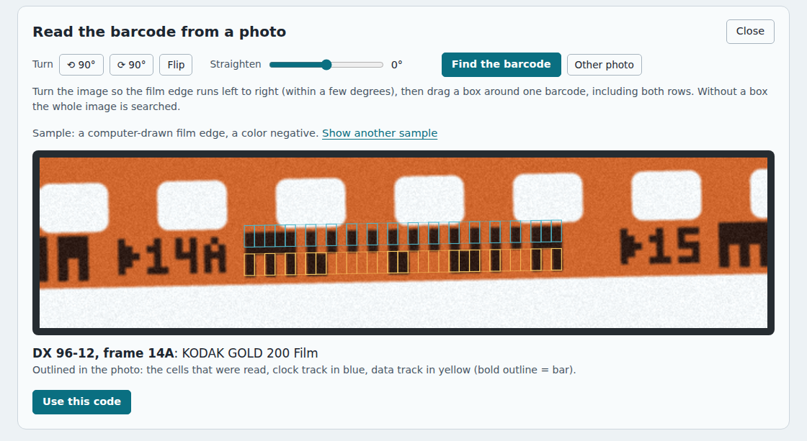

# 05 – Reading real film

**Question:** where exactly is the code on a negative, how big is it, which
way round should it be read, and does the documented layout match real film?

**Answer in short:** the code runs along the bottom edge, between the sprocket
holes and the film edge, about 13 mm long and under 2 mm tall, repeating every
19 mm. It is read with the wide clock mark first, which on correctly oriented
film is on the left. A photo of a real Kodak BW400CN negative decodes cell for
cell exactly as the documented layout predicts.

## Where the code is

Kodak's patent US 4,965,628 reserves the top edge of the film for
eye-readable information (maker, film type, frame numbers) and the bottom edge
for the barcode, with half-frame numbers and orientation arrows printed between
successive codes. The LIBC reader patent US 5,448,049 quotes the guaranteed
track positions of ANSI PH1.14-1990, measured from the film edge: the data
track within 0–0.030 in (0–0.76 mm) and the clock track within 0.050–0.073 in
(1.27–1.85 mm). alibosworth notes that the perforations can slightly overlap
the top of the clock track, so the upper part of a clock bar may be cut off.

Some cameras exposed further marks on the same edge, three or four times
wider than a DX bar; they are not part of the code
([report 07](07-history-and-related-markings.md#other-marks-along-the-film-edge)).

## Size, measured on a real negative

The formal dimensions are in ISO 1007, which was not available. Measured on
the Wikimedia photo *Kodak Telegraph negativ23a.jpg* (2,598 × 2,203 pixels),
using the standard 35 mm perforation pitch of 4.75 mm (8 per frame) as the
scale:

| Quantity | Pixels | Millimeters |
|---|---|---|
| Perforation pitch | ≈ 290 | 4.75 (scale) |
| One cell | 25.0 | ≈ 0.41 |
| Whole code, 31 cells | 775 | ≈ 12.7 |
| Height of one track | ≈ 55 | ≈ 0.9 |

These are estimates from a single photo. They agree with a code repeating
every 19 mm, with room for the printed label between codes, and they set the
proportions of the strip drawn by the tool (cell 1 : track height 2.1).

Two other sources agree. Kodak's US 5,665,950 gives the DX code a minimum
bar width of 0.015 in (0.38 mm), close to the measured cell. Zint's generator
draws each track 3 cells tall by default and no less than 2.2; its source
code says the ratio was measured on 35 mm film and varies "depending on the
brands". The tracks on the Kodak photo, at 2.2 cells, are at the low end.

## Validation: decoding a real negative

The code between the printed `23` and `23A` on that photo was cropped, and the
middle of each cell was sampled in both tracks:

| Track | Read from the negative | Expected |
|---|---|---|
| Clock | `1111101010101010101010101010111` | the standard 31-cell clock, exactly |
| Data | `101010 1001111 0 1111 010111 0 0 1 0101` | start, Part 1 = 79, empty, Part 2 = 15, frame 23, whole frame, empty, parity 1, stop |

Part 1 + Part 2 + frame contain 13 bars and the parity cell holds one, so the
total is even. DX 79-15 is *KODAK Professional BW400CN Film* in the I3A list,
matching the film name printed on the same strip, and the printed number just
before the code is `23`, matching the frame field. These bits are used as a
test case in `tests/unit/codec.test.mjs`.

The lower-resolution Wikimedia photo of an Agfa negative (DX 47-1, frame 22A)
was too small to sample reliably; its printed labels agree
([report 02](02-frame-numbers.md#what-is-printed-around-the-codes)).

Two practical observations from both photos shaped the tool's strip: the two
tracks touch, so clock and data bars in the same column merge into one tall
bar (the start pattern looks like a comb); and the printed number before each
code is roughly as tall as both tracks together.

## Which way round

- Read with the wide (5-cell) clock mark first. On both photos, with the
  printed numbers reading normally, the wide mark is on the left.
- Antoine Mérino advises reading on the shiny (base) side, not the matte
  (emulsion) side.
- Seen from the other side, everything is mirrored: the wide mark is on the
  right and the printed numbers are mirror-written. The tool's Mirror switch
  draws the strip that way so it can be copied as seen.
- Upside down (rotated 180°), the code runs above the perforations with the
  data track on top; turning the film fixes this.
- Machines handle both: the Kodak LIBC reader checks whether the entry and exit
  patterns arrive in the right order, and Fuji's reader in US 5,122,645 reads
  its buffer backwards when the end pattern comes first.

## Negatives and slides

On negatives the bars are exposed, so they are dense: dark on the clear or
orange-masked base. Reversal (slide) processing turns exposed areas clear, so
on slide film the bars appear as clear marks on the black edge. This follows
from how reversal processing works; none of the sources above describe slide
edge codes specifically. The tool's "Slide" look draws the strip that way, and
the photo reader detects either polarity by itself.

## Damage

- The code repeats every half frame, so a scratched, faded or notched copy can
  be checked against the next one along the film.
- Parity detects any single misread bar. The tool then lists every single-bar
  change that gives a valid code, with known films first.
- Photos of faded codes have little contrast; the photo reader reports a
  confidence value and warns when some cells are close to its threshold.

## Reading codes from photos

The photo reader (`site/js/dx-image.js`) works without any machine-learning or
external service:

1. Each row of the image, also tilted by up to ±3°, is normalized on its own
   (on color negatives the orange base lies halfway between dark bars and the
   white perforations, so one global threshold would fail).
2. Runs of bars and gaps are matched against the clock pattern, in either
   direction and for both layouts; the best match is refined by small shifts
   of the cell grid.
3. The clock track's known bars and gaps give the gray levels of "bar" and
   "gap" in this photo, in either polarity.
4. The data track is the neighboring row whose cells best fit the fixed
   start and stop patterns and the parity rule; bits are read in clock order,
   so mirrored or upside-down photos come out right.

It is tested on film edges drawn by the project's own renderer: color
negative, black-and-white and slide; mirrored and upside down; tilted by up to
2.5°; cells only 4 pixels wide; grain and blur; the 23-cell layout; leader
frames; a scratched-out bar; and a large image that has to be downscaled. A
code that fails its checks is only offered when its cells and its clock match
are clear-cut; otherwise the photo is reported as unclear rather than misread,
which is what happens to a code tilted by 7° (the page's Straighten control
fixes that). It needs at least 3–4 pixels per cell; strong perspective or
curled film is not handled. Photos larger than 1,600 pixels on the long side
are reduced first; reading a 1,600 × 1,200 photo takes about a quarter of a
second in Node.js (measured October 2026).

## Sources

All sources named above are listed in [report 06](06-sources-and-licensing.md#sources).
