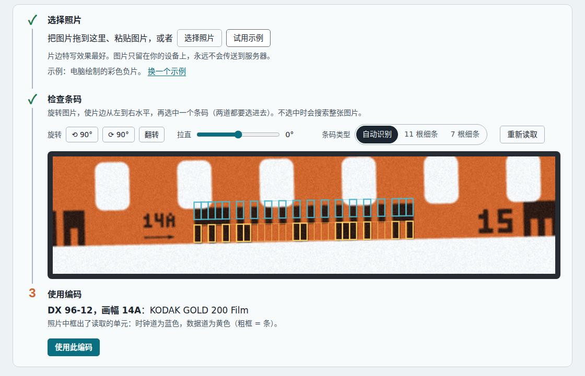

# 05 – 读取真实胶片

**问题**：条码在负片上的确切位置在哪里，有多大，应该朝哪个方向读，资料记载的格式与真实胶片是否相符？

**简短回答**：条码沿胶片的下边缘排列，位于片孔和片边之间，每 19 mm 重复一次。等同采用 ISO 1007:2000 的中国国家标准 GB/T 9185-2003 规定了它的尺寸：单元宽度 0.35–0.53 mm，两道合起来从片边向内延伸到 2.06–2.60 mm。一张真实的柯达负片符合这些范围：单元宽度 0.41 mm，两道延伸到距片边 2.3 mm 处；但它的 31 位条码长 12.6 mm，超过了该标准给出的含静区的条码长度 11.61 mm。读码时从时钟道的宽标记开始；胶片方向正确时，宽标记在左边。对这张负片的照片逐位解码，结果与该标准规定的格式完全一致。

## 条码的位置

GB/T 9185-2003 把潜影条码放在印有半画幅号的一侧片边上，紧挨着每个半画幅号（§6、§7.1）；另一侧片边上可以印全画幅号，或者印单道的画幅号条码（§6、§7.3）。柯达的专利 US 4,965,628 同样把胶片的上边缘留给肉眼可读的信息（制造厂、胶片类型、画幅号），把下边缘留给条码，相邻两个条码之间印有半画幅号和方向箭头。

从片边量起，数据道延伸到 0.75–1.26 mm 处，时钟道延伸到 2.06–2.60 mm 处（表 1 中的 T2 和 T3）；该标准的测量方法在 0.41 mm 和 1.63 mm 处扫描这两道（附录 B.2）。LIBC 条码读出器专利 US 5,448,049 引用了 ANSI PH1.14-1990 所保证的相近位置：数据道在 0–0.030 in（0–0.76 mm）范围内，时钟道在 0.050–0.073 in（1.27–1.85 mm）范围内。片孔从距片边 2.00 ± 0.15 mm 处开始（表 2 中的 E），所以时钟道可能伸进片孔所在的区域；alibosworth 指出，片孔可能与时钟道的顶部略有重叠，所以时钟道中条的上部可能会被切掉。

有些相机曾在同一边缘上另外曝光一些标记，宽度是潜影条码中条的三到四倍；它们不是条码的一部分（[报告 07](07-history-and-related-markings.zh-CN.md#片边上的其他标记)）。

## 尺寸

下表把 GB/T 9185-2003 表 1 中的尺寸与在一张真实负片上测得的值（见后文）并列：

| 项目 | 标准 | 实测 |
|---|---|---|
| 一个单元的宽度（T1） | 0.35–0.53 mm | 0.41 mm |
| 数据道，从片边量起（T2） | 0.75–1.26 mm | 1.0 mm |
| 两道，从片边量起（T3） | 2.06–2.60 mm | 2.3 mm |
| 片孔，从片边量起（表 2 中的 E） | 2.00 ± 0.15 mm | 2.0 mm |
| 整个条码（31 位） | 10.9–16.4 mm（31 × T1） | 12.6 mm |
| 含静区的条码（Y14） | 11.61 mm（基本尺寸） | 超过 12.6 mm |
| 条码两端的静区（T4） | 至少 0.38 mm | — |

除 Y14 外，就一张照片所能看出的而言，各项测量值都与该标准的范围相符：比例尺取自该标准的孔距，而该标准的尺寸适用于制造时的胶片（§4），并会随时间而改变（§5.1）。Y14 列为基本尺寸，即理论上的确切尺寸，本身没有限值（§3.4），而这张负片的条码比它长。31 位条码只有在单元最窄、静区最短时才短到 11.61 mm（31 × 0.35 + 2 × 0.38 = 11.61 mm）；按这张负片 0.41 mm 的单元宽度，条码本身就有 12.6 mm。对于带画幅号的条码，该标准不规定到下一个条码的距离（Y13，至少 6.35 mm）（注 8），但没有说明 Y14 对它们如何适用。

测量是在维基共享资源的照片 *Kodak Telegraph negativ23a.jpg*（2,598 × 2,203 像素）上、印字 `23` 与 `23A` 之间的条码处进行的。比例尺是孔距 4.75 mm（表 2 中的 B；每个画幅 8 个），取八个孔距的平均值；按这个比例尺，胶片宽 35.0 mm，该标准为 34.95 mm（表 2 中的 A）：

| 项目 | 像素 | 毫米 |
|---|---|---|
| 孔距 | 291 | 4.75（比例尺） |
| 胶片宽度 | 2,146 | 35.0 |
| 一个单元 | 25.0 | 0.41 |
| 整个条码（31 位） | 774 | 12.6 |
| 数据道 | 62 | 1.0 |
| 时钟道，片孔之间 | 79 | 1.3 |
| 时钟道，片孔处 | 60 | 1.0 |
| 片边到片孔 | 124 | 2.0 |

这些数值来自单张照片。时钟道延伸到片孔边缘以内，所以凡是有片孔的地方，时钟道的条都被截短了。在这张负片上，数据道高为单元宽度的 2.5 倍，时钟道高为 3.15 倍（被片孔截短处为 2.4 倍）。页面上的片条、照片读取的示例图片和上面的示意图则把两道都画成单元宽度的 2.525 倍（1.03 mm）高，因为两道等高更好看；这是该标准允许的最小等高值（T3：两道合计至少 2.06 mm）。其余都按这张负片绘制：片孔采用标准的尺寸、孔距和到片边的距离，相对于条码的位置与这张负片相同。

另外两个来源与此一致。柯达 1995 年申请的 US 5,665,950 给出潜影条码的最小条宽为 0.015 in（0.38 mm）；该标准的 2000 年版允许的单元宽度比 GB/T 9185-1996（即 1993 年草案）更窄（前言，第 d 项），最小为 0.35 mm。Zint 的生成器默认把每一道画成单元宽度的 3 倍高，且不少于 2.2 倍；其源代码说，这个比例是在 135 规格胶片上测得的，并且会有变化，“depending on the brands”（取决于品牌）。柯达照片上两道的高度为单元宽度的 2.5 倍和 3.15 倍，与这个默认值接近。

## 验证：解码一张真实负片

从这张照片上裁下印字 `23` 与 `23A` 之间的条码，并在两道上对每个单元的中间取样：

| 道 | 从负片上读出 | 预期 |
|---|---|---|
| 时钟道 | `1111101010101010101010101010111` | 与标准的 31 位时钟道完全一致 |
| 数据道 | `101010 1001111 0 1111 010111 0 0 1 0101` | 输入模式，第 1 部分 = 79，未指定位，第 2 部分 = 15，画幅号 23，全画幅位置，未指定位，奇偶检验位 1，输出模式 |

第 1 部分 + 第 2 部分 + 画幅号共有 13 根条，奇偶检验位中有一根，所以总数是偶数。在 I3A 列表中，DX 79-15 是 *KODAK Professional BW400CN Film*，与同一段胶片上印的胶片名称相符；紧挨在条码前面的肉眼可读的画幅号是 `23`，与画幅号字段相符。这组位被用作 `tests/unit/codec.test.mjs` 中的一个测试用例。

维基共享资源上那张分辨率较低的爱克发负片照片（DX 47-1，画幅号 22A）太小，无法可靠取样；它的片边印字是相符的（[报告 02](02-frame-numbers.zh-CN.md#条码周围的印字)）。

两张照片中的两点实际观察决定了工具中片条的样子：两道紧挨在一起，所以同一列上时钟道的条和数据道的条会连成一根高条（输入模式看起来像一把梳子）；每个条码前面的画幅号很大。在这张柯达负片上，全画幅号高 3.4 个单元宽度（1.4 mm），离片边 0.6 个单元宽度，在条码前 1.6 个单元宽度处；半画幅号（A）高 2 个单元宽度，下面有箭头，在条码前 2.8 个单元宽度处。下一个画幅号在条码之后至少 4.3 个单元宽度处才开始，所以只显示一个条码的片条只画出它前面的画幅号。

## 朝哪个方向读

- 从时钟道的宽标记（5 位）开始读。在两张照片上，片边上的画幅号正常可读时，宽标记都在左边。
- Antoine Mérino 建议从有光泽的一面（片基面）读，而不是从哑光的一面（乳剂面）读。
- 从另一面看，一切都是镜像的：宽标记在右边，片边上的画幅号是反写的。工具的镜像开关会把片条画成这样，以便按看到的样子照抄。
- 上下颠倒（旋转 180°）时，条码位于片孔上方，数据道在上面；把胶片掉转过来即可纠正。
- GB/T 9185-2003 画的胶片相对于这个方向转了 180°：在它的图 1 中，条码沿上边缘排列，从右边开始，印出的数字是倒着的。
- 机器两种方向都能处理：柯达的 LIBC 条码读出器会检查输入模式和输出模式是否按正确的顺序出现，富士 US 5,122,645 中的条码读出器在先遇到输出模式时会倒着读取缓冲区。

## 负片与反转片

在负片上，条是曝光过的，所以密度高：在透明片基或橙色片基上呈深色。该标准是为彩色负片加工设计这种条码的，在其他胶片上它是可选的（§7.1）。它规定了加工后的反差（假定胶片在曝光前后都按推荐条件保存、未超过有效期，并按既定标准加工）：空的 M 状态红密度不超过 0.50，条的密度至少比空高 0.50；空在 690 nm 处的密度不超过 0.65，条的密度至少比空高 0.90（§7.4）。反转加工会让曝光过的区域变得透明，所以在反转片上，条在黑色的片边上显示为透明的标记。这是由反转加工的原理推出的；包括该标准在内，所有来源都没有描述反转片上的潜影条码。选择片条下方黑色的那一小块胶片（“反转片”外观），工具就会这样绘制片条；照片读取也能自行识别两种极性。

用彩色负片药液加工的黑白片，看起来和彩色负片一样。关于用 C-41 加工的 BW400CN，柯达写道：“The appearance of processed negatives on BW400CN Film is similar to color negative films, but with no color in the negative images”（加工后的 BW400CN 负片看起来与彩色负片相似，只是负像没有颜色）（F-4036）。因此，页面上的 BW400CN 示例使用彩色负片外观。

## 损伤

- 条码每半画幅重复一次，所以带划痕、褪色或被切口切到的条码，可以和胶片上的下一个条码对照检查。
- 奇偶检验能发现任何单根条的误读。这时工具会列出所有只改一位就能得到有效编码的改动，对应已知胶片的改动列在前面。
- 褪色条码的照片反差低；照片读取会给出置信度，并在有些单元接近其阈值时发出警告。

## 从照片读取条码

照片读取（`site/js/dx-image.js`）不依赖任何机器学习或外部服务：

1. 图像的每一行（以及倾斜最多 ±3° 的行）都单独归一化（在彩色负片上，橙色片基的亮度处在深色条和白色片孔的正中间，所以用一个全局阈值会失败）。
2. 把条和空的连续段与时钟道图案进行匹配，正反两个方向、两种条码都会尝试；再通过小幅移动网格来细化最佳匹配。较高的时钟道也能与略微倾斜的直线相符，所以采用的斜率，是与最佳匹配几乎一样好的行最多的那个斜率。
3. 时钟道上已知的条和空给出这张照片中“条”和“空”的灰度，无论是哪种极性。
4. 在相邻各行中，取单元最符合固定的输入模式、输出模式和奇偶检验规则的一行作为数据道；候选行必须大部分固定单元正确，而且它读出的位，必须有至少半个单元高度的行读出同样的结果：两道交界处的单独一行可能读错一根条，却仍然通过奇偶检验；而空白的胶片，各行读出的结果也彼此一致。各单元按时钟道的顺序读取，所以镜像或上下颠倒的照片也能得到正确结果。
5. 如果找不到时钟道，就再看一遍，这次考虑到条码可能褪色或受损：对比度更低，沿胶片方向的光线有变化，以及时钟道上有一根条被划掉或一个空被填上。这一遍只给出通过检查的读数，并附一句说明：这些条较淡或有损伤。

它在本项目自己的渲染器画出的片边上测试过：彩色负片、黑白负片和反转片；镜像和上下颠倒；倾斜最多 2.5°；每个单元只有 4 像素宽；颗粒和模糊；23 位条码；片头画幅；以及一根被划掉的条。这些情况都各用四组道高画出：柯达负片上实测的道高，页面所画的等高两道，以及该标准允许的最窄和最宽的数据道（T2 为 0.75 mm 和 1.26 mm）。只用等高两道测试的还有：褪色的条码，在第二遍读出；沿胶片方向逐渐变暗的光线；时钟道上有一根条被划掉或一个空被填上，这样的照片大多能读出，没有一张读错；以及需要缩小的大图，其中一张的单元只有 3 像素宽、尺寸刚超过上限。未通过检查的编码，只有在其各单元和时钟道的匹配都很明确、并且有一组行读出同样的位时才会给出；否则会把照片报告为不清楚，而不是读错。倾斜超过所搜索的 ±3° 时，条码往往仍能被正确读出，或者不给出读数，但并非总是如此。在 5–12° 的测试中（2026 年 10 月），如果片孔看起来像条（反转片的片孔后面透光，或负片的片孔后面是深色背景），31 位条码的照片中有 5%–7% 被读成另一种胶片的 23 位条码，而且没有警告，不过读数仍会注明这是不含画幅号的旧式 7 根细条编码。片孔看起来不像条时，没有一张读错。用页面上的拉直控件把这样的照片转正后，就能正确读出；把照片读取的“条码类型”设为“11 根细条”后，它只查找这种条码，于是会说明没有找到时钟道，或找到了条码但无法可靠读取，而不是读错。它要求每个单元至少 3–4 像素；不能处理明显的透视变形或卷曲的胶片。长边超过 1,600 像素的照片会先缩小到这个尺寸，每个新像素取它所覆盖区域的平均值，所以刚超过上限的照片几乎保留全部细节。在 Node.js 中读取一张 1,600 × 1,200 的照片大约需要四分之一秒（2026 年 10 月测得）。在页面上，搜索每运行约 10 毫秒就让浏览器绘制页面、响应操作一次，所以搜索期间页面不会卡住。

## 来源

上文提到的所有来源都列在[报告 06](06-sources-and-licensing.zh-CN.md#来源) 中。
