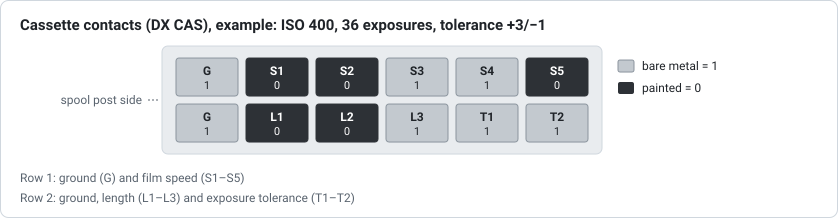

# 07 – History and related markings

**Question:** when did the DX edge code appear and change, and which other
markings on film and cassettes belong to the DX system or are easily confused
with it?

**Answer in short:** Kodak introduced DX encoding in January 1983 with three
markings: contacts on the cassette for cameras, a barcode on the cassette for
photofinishers, and the latent barcode on the film edge. Around 1989–1990 Kodak
extended the edge code with a frame number (the "DXN code"), while Fuji
introduced a separate frame-number barcode on the opposite edge. The original
23-cell edge code stayed in wide use through at least the mid-1990s. ISO 1007,
in its 2000 edition adopted in China as GB/T 9185-2003, still has the 23-cell
code as the basic code and offers both ways of adding frame numbers.

## Timeline

| Year | Event | Source |
|---|---|---|
| 1977 | Fuji encodes film speed with electrical contacts on 135 cassettes | Wikipedia, *DX encoding* (citing Fuji's US patent 4,024,557) |
| January 3, 1983 | Kodak introduces DX encoding: cassette contacts, cassette barcode and edge barcode | Wikipedia, *DX encoding* |
| March 1983 | First DX-coded film, Kodacolor VR 1000 | Wikipedia, *DX encoding* |
| 1984–1985 | First cameras to set film speed from the cassette (e.g. Pentax Super Sport 35, Minolta AF-E; SLRs from 1985) | Wikipedia, *DX encoding* |
| 1988 | First edition of China's standard for 135 film and cassettes, GB/T 9185-1988 | GB/T 9185-2003, foreword |
| late 1980s | Fuji film with a dedicated frame-number barcode on the edge opposite the DX code | Kodak, EP 0838718 |
| 1989 | Fuji patent application for readers of DX codes and separate frame-number barcodes (a "three of nine" code) | Fuji, US 5,122,645 |
| 1989–1990 | Kodak's 31-cell code with frame number, filed 1989, granted 1990; "generally referred to as a DXN code" | Kodak, US 4,965,628; EP 0838718 |
| 1994 | ANSI PH1.14 superseded by NAPM IT1.14; DX now part of ISO 1007 (latest revision 2000) | Wikipedia, *DX encoding* |
| 1995 | ISO 1007:1995 published | GB/T 9185-2003, foreword |
| 1995 | Kodak still describes the DX code as "a 23-bit, two track DX bar code" | Kodak, US 5,665,950 |
| 1996 | China adopts the 1993 draft of ISO 1007 as GB/T 9185-1996, with frame-number codes up to 36A | GB/T 9185-2003, foreword |
| 1996 | DX-iX introduced with the Advanced Photo System (APS) | Wikipedia, *DX encoding* |
| 1997 | Kodak notes "a substantial usage of DX coded film" without frame-number codes | Kodak, EP 0838718 |
| 1998 | Fuji's "Barcode System" for 120 and 220 roll film | Wikipedia, *DX encoding* |
| 2000 | ISO 1007:2000; compared with GB/T 9185-1996, it adds the single-track frame-number barcode as an option, frame-number codes beyond 36A, narrower cells, new roll-length codes on the cassette barcode and "augmented" cassette numbers | GB/T 9185-2003, foreword |
| 2003 | China publishes GB/T 9185-2003, an identical adoption of ISO 1007:2000, issued November 10, 2003, in force from May 1, 2004 | GB/T 9185-2003 |
| 2008–2009 | Last I3A lists of DX numbers ([report 03](03-dx-numbers-and-registry.md)) | I3A; Wikipedia, *DX number* |

## Cassette contacts (DX CAS)

The cassette carries a 2 × 6 grid of contact areas, each either bare metal
(conductive, connected to ground) or painted (insulated). With the spool post on
the left, the left-most area of each row is ground:

| Row | Contacts |
|---|---|
| 1 | G, S1, S2, S3, S4, S5 (areas 1–6): film speed |
| 2 | G, L1, L2, L3 (areas 7–10): film length; T1, T2 (areas 11, 12): exposure tolerance |

GB/T 9185-2003 calls them the camera auto-sensing areas (§10) and numbers them
1–6 along one row and 7–12 along the other; 1 and 7 are the common contacts.
In the tables below, 1 means bare metal. The values come from Wikipedia's
*DX encoding* article, and the standard's Tables 11–13 give the same ones,
except where noted.

**Film speed (S1–S5).** 24 speeds from ISO 25/15° to 5000/38° in third
stops. S1–S3 select a group of three speeds (read with S1 as the lowest bit) and
S4–S5 add 0 (`10`), ⅓ (`01`) or ⅔ (`11`) of a stop:

| ISO | S1–S5 | ISO | S1–S5 | ISO | S1–S5 |
|---|---|---|---|---|---|
| 25 | `00010` | 200 | `11010` | 1600 | `01110` |
| 32 | `00001` | 250 | `11001` | 2000 | `01101` |
| 40 | `00011` | 320 | `11011` | 2500 | `01111` |
| 50 | `10010` | 400 | `00110` | 3200 | `11110` |
| 64 | `10001` | 500 | `00101` | 4000 | `11101` |
| 80 | `10011` | 640 | `00111` | 5000 | `11111` |
| 100 | `01010` | 800 | `10110` | | |
| 125 | `01001` | 1000 | `10101` | | |
| 160 | `01011` | 1250 | `10111` | | |

The eight codes ending in `00` are listed as "custom 1" to "custom 8"; the
standard does not list them, but has a row for a cassette with no speed code.
Many cameras read only some contacts; reading S1, S2 and ground is enough to
tell 100, 200, 400 and 800 apart.

**Film length (L1–L3).** `000` other, `100` 12, `010` 20, `110` 24, `001` 36,
`101` 48, `011` 60, `111` 72 exposures. The article's text says only 12, 20, 24
and 36 are used in practice. The standard lists only 12, 24, 36 and `000` for
any non-standard length; a note adds that 20 exposures used to be a standard
length, coded `010`, and that existing cameras may still read that code as 20.
The codes for 48, 60 and 72 come only from Wikipedia.

**Exposure tolerance (T1–T2).** `00` ±½ stop, `10` ±1, `01` +2/−1, `11` +3/−1.

This tool does not use the contacts: they are on the cassette, not the film.

## Cassette barcode

The six-digit barcode next to the film slot carries the same DX number as the
edge code, except on the few cassettes with an augmented number; it is
described in [report 03](03-dx-numbers-and-registry.md).
Kodak's US 5,761,558 also describes an "enhanced" eight-digit cassette barcode,
printed above a shortened standard code, carrying order information such as
promotions, single-use cameras or panoramic format.

## Information panel

GB/T 9185-2003 counts a fourth marking as part of DX (§3.6): an information
panel on the cassette, seen through a window in the back of cameras that have
one, showing the film's name, its ISO speed or the maker's recommended exposure
index, and the number of exposures (§11). The cassette must also say clearly
which processing the film needs (§12).

## Other marks along the film edge

- **Fuji's frame-number barcode.** Some Fuji film carries a second barcode on
  the edge opposite the DX code. It holds only the frame number and is
  described in the next section.
- **Camera-exposed "fat bits".** Some cameras exposed additional marks along
  the edge after manufacture, zero to two per frame, with bars "three or four
  times greater" in width than DX bars (Kodak's US 5,665,950). They are not
  part of the DX code.
- **Printed labels.** Frame numbers and arrows between the codes are described
  in [report 02](02-frame-numbers.md); the film name and other eye-readable
  information run along the opposite edge (Kodak's US 4,965,628).

## Fuji's frame-number barcode

Kodak's EP 0838718 says that "in the late 1980's, Fuji Photo Film, Ltd.,
introduced a film that incorporated a dedicated frame number bar code on the
opposite edge of the film from the DX coded edge". Fuji's patents describe the
code; one from 1997 calls it the "FNS (film number system) code"
(US 6,324,345). ISO 1007:2000 includes it as an option, added after the 1993
draft:
GB/T 9185-2003 describes a 13-element, single-track, modified three-of-nine
code (§7.1, §7.3).

- **Where it is.** Like the DX code, it is exposed at the factory and appears
  when the film is developed. It runs between the perforations and the edge
  opposite the DX code, right after each printed frame number, at the same
  pitch as the DX codes: one per half frame (US 5,122,645; US 6,324,345). The
  standard puts the nearer end of each code 2.60–3.60 mm from the middle of its
  printed number (Table 1, T8).
- **What it holds.** Only the frame position: 00, 00A, 0, 0A, 1, 1A … 36, 36A
  and E (US 5,336,873); on some film "S" takes the place of 0
  (US 5,122,645). On 12-, 20- and 24-exposure rolls, frames 12, 12A, 20, 20A,
  24 and 24A can carry a variant that also gives the roll length: "These
  specific frame number bar codes indicate the exposed number of frames in
  addition to the frame numbers" (US 5,336,873). The code says nothing about
  the film itself. Table 6 of the standard lists the same positions, 83 codes
  in all, as many as the patent's figures. The codes for 00 to 0A are printed
  only where those numbers are printed, and E is an optional end-of-roll code
  one frame after the code of the last whole frame (§7.3.1.2).
- **How it is built.** A single row, with no clock track (JP H02-45890 A).
  Each code has 13 elements: "one wide bar followed by one narrow space", then
  "five bars elements interleaved with four space elements, three of these
  nine elements being wide and the remaining six being narrow", then "one
  narrow space followed by one narrow bar" (US 6,324,345). A wide element is
  twice as wide as a narrow one, and a narrow element is as wide as a DX bar
  (US 5,122,645). The wide start bar shows which way to read the code. The
  standard describes the same structure, with a wide element standing for 1
  and a narrow one for 0 (§7.3), and sets wide elements at 0.95–1.11 mm and
  narrow ones at 0.38–0.54 mm, with at least 1.5 mm of blank space at each end
  (Table 1, T5–T7). Neither the patents nor the standard describe a check
  character.
- **Values.** US 5,336,873 gives all 83 codes in its FIGS. 5A–5D. In
  US 5,122,645, frame 12A is `1000100001100` (1 is a wide element), with
  `001000011` in the nine data elements; the standard's Table 6 gives the same
  for 12A.
- **Which film.** Fuji's 1997 patent says: "Since the expanded DX code contains
  a portion representing the frame number, the code FNS is not recorded when
  the expanded DX code is recorded" (US 6,324,345). Film with this code
  therefore has the original 23-cell DX code, with 7 thin bars. The standard
  likewise offers the two as alternatives: frame numbers are coded either by
  eight more cells in the DX code or by this code on the opposite edge (§7.1).
  Fujifilm's data sheet for FUJICOLOR C200 shows a single latent-image
  barcode on 135 film.
- The tool does not read this code: it repeats the frame number printed next
  to it, adding only the roll length on the last frames of 12-, 20- and
  24-exposure rolls. This project has not checked the values against real
  film.

## Other formats

- **APS (IX240).** The Advanced Photo System of 1996 uses its own cartridge,
  film size and "DX-iX" information exchange. The 2008 I3A list reserves nine
  Part 1 numbers for APS film ([report 03](03-dx-numbers-and-registry.md)).
- **120 and 220 roll film.** Fuji's 1998 "Barcode System" puts a 13-bit barcode,
  giving format, length, speed and film type, on the sticker between the film
  and its backing paper, for cameras that scan it. It is unrelated to the 35 mm
  edge code.

## Sources

All sources named above are listed in [report 06](06-sources-and-licensing.md#sources).
