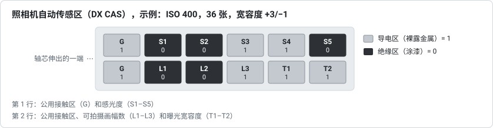

# 07 – 历史与相关标记

**问题**：DX 潜影条码是什么时候出现和变化的，胶片和暗盒上还有哪些标记属于 DX 系统，或者容易与它混淆？

**简短回答**：柯达于 1983 年 1 月推出 DX 编码，包括三种标记：暗盒上的照相机自动传感区，暗盒上供冲洗店使用的条码，以及片边上的潜影条码。1989–1990 年前后，柯达在潜影条码中加入了画幅号（即“DXN code”），而富士则在另一侧片边上推出了单独的画幅号条码。最初的 23 位潜影条码至少到 1990 年代中期仍被广泛使用。ISO 1007 的 2000 年版（中国等同采用为 GB/T 9185-2003）仍把 23 位条码作为基本条码，并同时提供两种加入画幅号的方式。

## 时间线

| 年份 | 事件 | 来源 |
|---|---|---|
| 1977 | 富士用 135 规格暗盒上的电触点对感光度进行编码 | 维基百科，*DX encoding*（引用富士的美国专利 4,024,557） |
| 1983 年 1 月 3 日 | 柯达推出 DX 编码：照相机自动传感区、暗盒条码和潜影条码 | 维基百科，*DX encoding* |
| 1983 年 3 月 | 第一款 DX 编码胶片，Kodacolor VR 1000 | 维基百科，*DX encoding* |
| 1984–1985 | 第一批根据暗盒设定感光度的相机（例如 Pentax Super Sport 35、Minolta AF-E；单反相机从 1985 年开始） | 维基百科，*DX encoding* |
| 1988 | 中国 135 规格胶片和暗盒标准的第一版 GB/T 9185-1988 | GB/T 9185-2003，前言 |
| 1980 年代末 | 富士的胶片在 DX 潜影条码对侧的片边上带有专用的画幅号条码 | 柯达，EP 0838718 |
| 1989 | 富士关于 DX 潜影条码和单独的画幅号条码（一种“three of nine”码，即三九条码）的条码读出器的专利申请 | 富士，US 5,122,645 |
| 1989–1990 | 柯达带画幅号的 31 位条码，1989 年提交申请，1990 年获得授权；“generally referred to as a DXN code”（通常称为 DXN 码） | 柯达，US 4,965,628；EP 0838718 |
| 1994 | ANSI PH1.14 被 NAPM IT1.14 取代；DX 现为 ISO 1007 的一部分（最新修订版为 2000 年版） | 维基百科，*DX encoding* |
| 1995 | ISO 1007:1995 发布 | GB/T 9185-2003，前言 |
| 1995 | 柯达仍把潜影条码描述为“a 23-bit, two track DX bar code”（23 位、双道的 DX 条码） | 柯达，US 5,665,950 |
| 1996 | 中国等同采用 ISO 1007 的 1993 年草案，发布为 GB/T 9185-1996，其画幅号编码到 36A 为止 | GB/T 9185-2003，前言 |
| 1996 | DX-iX 随 APS（先进摄影系统）推出 | 维基百科，*DX encoding* |
| 1997 | 柯达指出，有“a substantial usage of DX coded film”（大量 DX 编码胶片）不带画幅号编码 | 柯达，EP 0838718 |
| 1998 | 富士用于 120 和 220 胶片的“Barcode System”（条码系统） | 维基百科，*DX encoding* |
| 2000 | ISO 1007:2000；与 GB/T 9185-1996 相比，它增加了可选的单道画幅号条码、大于 36A 的画幅号编码、更窄的单元宽度、暗盒条码上新的可拍摄画幅数编码和“增补”暗盒条码 | GB/T 9185-2003，前言 |
| 2003 | 中国发布等同采用 ISO 1007:2000 的 GB/T 9185-2003（2003 年 11 月 10 日），2004 年 5 月 1 日实施 | GB/T 9185-2003 |
| 2008–2009 | I3A 最后几版的 DX 码列表（[报告 03](03-dx-numbers-and-registry.zh-CN.md)） | I3A；维基百科，*DX number* |

## 照相机自动传感区（DX CAS）

暗盒上有一个 2 × 6 的传感区网格，每个区要么是导电区（裸露的金属，与公用接触区相连），要么是绝缘区（涂了漆）。轴芯伸出的一端朝左时，每一行最左边的区是公用接触区：

| 行 | 传感区 |
|---|---|
| 1 | G、S1、S2、S3、S4、S5（第 1–6 区）：感光度 |
| 2 | G、L1、L2、L3（第 7–10 区）：可拍摄画幅数；T1、T2（第 11、12 区）：曝光宽容度 |

GB/T 9185-2003 在 §10 中规定了这些传感区，一行编为 1–6，另一行编为 7–12；1 和 7 是公用接触区。在下面的表格中，1 表示导电区。这些数值来自维基百科的 *DX encoding* 条目，该标准的表 11–13 给出的数值与之相同，另有说明的除外。

**感光度（S1–S5）**。共 24 档感光度，从 ISO 25/15° 到 5000/38°，以三分之一档为间隔。S1–S3 选出一组三档感光度（读取时 S1 为最小的二进制位），S4–S5 再加上 0（`10`）、⅓（`01`）或 ⅔（`11`）档：

| ISO | S1–S5 | ISO | S1–S5 | ISO | S1–S5 |
|---|---|---|---|---|---|
| 25 | `00010` | 200 | `11010` | 1600 | `01110` |
| 32 | `00001` | 250 | `11001` | 2000 | `01101` |
| 40 | `00011` | 320 | `11011` | 2500 | `01111` |
| 50 | `10010` | 400 | `00110` | 3200 | `11110` |
| 64 | `10001` | 500 | `00101` | 4000 | `11101` |
| 80 | `10011` | 640 | `00111` | 5000 | `11111` |
| 100 | `01010` | 800 | `10110` | | |
| 125 | `01001` | 1000 | `10101` | | |
| 160 | `01011` | 1250 | `10111` | | |

以 `00` 结尾的八个编码被列为“custom 1”到“custom 8”（自定义 1 到 8）；该标准没有列出它们，但有一行表示暗盒未编感光度码。很多相机只读取部分传感区；读取 S1、S2 和公用接触区就足以区分 100、200、400 和 800。

**可拍摄画幅数（L1–L3）**。`000` 其他，`100` 12 张，`010` 20 张，`110` 24 张，`001` 36 张，`101` 48 张，`011` 60 张，`111` 72 张。该条目的正文说，实际使用的只有 12、20、24 和 36 张。该标准只列出 12、24、36 张，以及表示任何非标准长度的 `000`；一条注释补充说，20 张以前是标准长度，编码为 `010`，现有的相机可能仍把这个编码读作 20 张。48、60 和 72 张的编码只见于维基百科。

**曝光宽容度（T1–T2）**。`00` ±½ 档，`10` ±1，`01` +2/−1，`11` +3/−1。

**一个真实的暗盒**。在维基共享资源的照片 *DX-Codierung asb PICT3739.JPG* 中，暗盒条码和印出的数字都是 105514：在 2008 年年度报告中是 DX 34-7，FUJICHROME SENSIA II 100，36 张。传感区与之一致：第 1、3、5、7 和 10 区是导电区，即 ISO 100（`01010`）、36 张（`001`）和 ±½ 档（`00`）。暗盒嘴朝下时，传感区在暗盒的上部，暗盒条码在它们下方，数字印在暗盒条码和暗盒嘴之间。该标准把两行传感区放在绕暗盒 191.7° 和 225.6° 处（表 10），让条码的条至少从 257° 延伸到 294°（表 8）。解码器页面上暗盒条码查询旁边的图画的就是这个暗盒。

本工具不使用这些传感区：它们在暗盒上，而不在胶片上。

## 暗盒条码

暗盒嘴旁边的六位数条码带有与潜影条码相同的 DX 码（少数采用增补编号的暗盒除外）；它在[报告 03](03-dx-numbers-and-registry.zh-CN.md) 中有介绍。柯达的 US 5,761,558 还描述了一种“enhanced”（增强型）八位数暗盒条码，印在缩短的标准条码上方，带有订单信息，例如促销、一次性相机或全景画幅。

## 暗盒信息板

GB/T 9185-2003 把第四种标记也算作 DX 的一部分（§3.6）：暗盒上的信息板，透过相机背面的窗口（如果相机有的话）可以看到，上面有胶片名称、ISO 感光度或制造厂推荐的曝光指数，以及可拍摄画幅数（§11）。暗盒上还必须清楚地写明胶片需要的加工类型（§12）。

## 片边上的其他标记

- **富士的画幅号条码**。有些富士胶片在 DX 潜影条码对侧的片边上还有第二种条码。它只包含画幅号，下一节专门介绍。
- **相机曝光的“fat bits”（宽条标记）**。有些相机曾在胶卷出厂后沿片边额外曝光一些标记，每个画幅零到两个，其中的条在宽度上比潜影条码的条“three or four times greater”（大三到四倍）（柯达的 US 5,665,950）。它们不属于潜影条码。
- **片边印字**。条码之间的画幅号和箭头在[报告 02](02-frame-numbers.zh-CN.md) 中有介绍；胶片名称和其他肉眼可读的信息印在对侧片边上（柯达的 US 4,965,628）。

## 富士的画幅号条码

柯达的 EP 0838718 写道：“in the late 1980's, Fuji Photo Film, Ltd., introduced a film that incorporated a dedicated frame number bar code on the opposite edge of the film from the DX coded edge”（1980 年代末，富士推出了在 DX 潜影条码对侧片边上带专用画幅号条码的胶片）。富士的专利描述了这种条码，其中 1997 年的一项称它为“FNS (film number system) code”（胶片编号系统码）（US 6,324,345）。ISO 1007:2000 把它列为标准中的一种可选条码，这是在 1993 年草案之后才加入的：GB/T 9185-2003 把它描述为“13 位单道改良的三九潜影条码”（§7.1、§7.3）。

- **位置**。它和 DX 潜影条码一样在工厂里曝光，加工后显现。它位于 DX 潜影条码对侧的片孔与片边之间，紧跟在每个肉眼可读的画幅号之后，间距与 DX 潜影条码相同：每半画幅一个（US 5,122,645；US 6,324,345）。该标准规定，条码较近的一端距它所属的画幅号数字的中心 2.60–3.60 mm（表 1 中的 T8）。
- **内容**。只有画幅的位置：00、00A、0、0A、1、1A……36、36A 和 E（US 5,336,873）；有些胶片用“S”代替 0（US 5,122,645）。在 12 张、20 张和 24 张的胶卷上，画幅 12、12A、20、20A、24 和 24A 可以用一种变体，同时给出可拍摄画幅数：“These specific frame number bar codes indicate the exposed number of frames in addition to the frame numbers”（这些特定的画幅号条码除画幅号外还表示可拍摄画幅数）（US 5,336,873）。这种条码不包含胶片本身的任何信息。该标准的表 6 列出了同样的位置，共 83 个条码，与专利附图中的数量相同。00 到 0A 的条码只在印有这些数字的地方才印（表 6 注 1）；E 是可选的卷端序列，位于最后一个全画幅号的条码之后一个全画幅距处（§7.3.1.2）。
- **结构**。只有一道，没有时钟道（JP H02-45890 A）。每个条码有 13 个单元：先是“one wide bar followed by one narrow space”（一根宽条加一个窄空），然后是“five bars elements interleaved with four space elements, three of these nine elements being wide and the remaining six being narrow”（五个条单元与四个空单元交替排列，这九个单元中三个宽、六个窄），最后是“one narrow space followed by one narrow bar”（一个窄空加一根窄条）（US 6,324,345）。宽单元的宽度是窄单元的两倍，窄单元与 DX 潜影条码的一根条一样宽（US 5,122,645）。开头的宽条表示读取方向。该标准描述的结构相同，宽单元表示 1，窄单元表示 0（§7.3），并规定宽单元为 0.95–1.11 mm，窄单元为 0.38–0.54 mm，两端的静区至少各有 1.5 mm（表 1 中的 T5–T7）。专利和该标准都没有描述校验字符。
- **取值**。US 5,336,873 在图 5A–5D 中列出了全部 83 个条码。在 US 5,122,645 中，画幅 12A 是 `1000100001100`（1 表示宽单元），九个数据单元为 `001000011`；该标准的表 6 给出的 12A 也是这个值。
- **哪些胶片**。富士 1997 年的专利写道：“Since the expanded DX code contains a portion representing the frame number, the code FNS is not recorded when the expanded DX code is recorded”（扩展的 DX 潜影条码中已有表示画幅号的部分，所以记录扩展的 DX 潜影条码时不再记录 FNS）（US 6,324,345）。因此，带这种条码的胶片使用的是最初的 23 位 DX 潜影条码，时钟道有 7 根细条。该标准同样把两者列为二选一的方式：画幅号要么用 DX 潜影条码中再增加的 8 位来编码，要么用另一侧片边上的这种条码（§7.1）。富士 FUJICOLOR C200 的数据表显示，135 规格胶片上只有一种潜影条码。
- 本工具不读取这种条码：它重复旁边肉眼可读的画幅号，只在 12 张、20 张和 24 张胶卷的最后几个画幅上多给出可拍摄画幅数。本项目也没有用实际胶片核对这些取值。

## 其他胶片规格

- **APS（IX240）**。1996 年的先进摄影系统使用自己的暗盒、胶片尺寸和“DX-iX”信息交换。2008 年的 I3A 列表为 APS 胶片保留了九个第 1 部分编号（[报告 03](03-dx-numbers-and-registry.zh-CN.md)）。
- **120 和 220 胶片**。富士 1998 年的“Barcode System”（条码系统）把一个 13 位的条码放在胶片与背纸之间的贴纸上，给出规格、长度、感光度和胶片类型，供能扫描它的相机使用。它与 135 规格胶片的潜影条码无关。

## 来源

上文提到的所有来源都列在[报告 06](06-sources-and-licensing.zh-CN.md#来源) 中。
